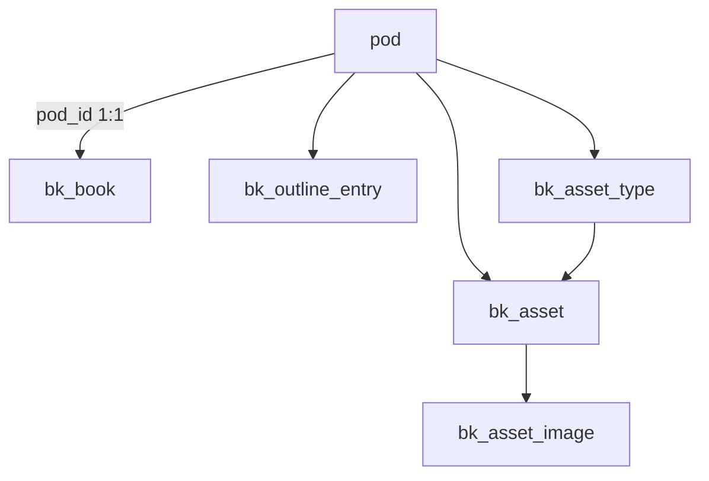

# Book pod — implementation plan (plan-only)

**Repo:** [CoolColdUK/simpleOutcomeDev](https://github.com/CoolColdUK/simpleOutcomeDev)  
**Status:** Matthew locked product decisions (Nov 2026) — see **Decisions (locked)**. Plan-only on this branch until implementation PR; post–PR #29 base (no `shopping_list`).  
**Related:** [api-mcp.md](../plan/feature/api-mcp.md), [trip-planning.md](../plan/feature/trip-planning.md), [todo_list_kanban_213294b6.plan.md](./todo_list_kanban_213294b6.plan.md), [so_app_spaces_pwa_188a72d7.plan.md](./so_app_spaces_pwa_188a72d7.plan.md)

---

## Summary (Matthew’s requirements)

| Area | Requirement |
| --- | --- |
| Pod | One **book** per pod: **name** (`pod.name`), **markdown summary**, optional **subtitle** (`bk_book.subtitle`), **cover image** (optional while drafting; EPUB uses **placeholder** if missing). Shown in a **collapsed accordion** at top of workspace. |
| Outline | **Chapters**: number, title, summary, content (markdown), status `outline` \| `draft` \| `done`. **Notes**: only other entry type; inserted **after any chapter** in the global order; labeled Note 1, Note 2 (independent of chapter numbers). |
| Ordering | **Drag-and-drop** reorder of the combined outline; **chapter numbers** and **note numbers** **renumber automatically** (dense 1..n within each kind). |
| List UI | Pod outline list shows **chapter number + title** or **note label**; **filter** by type: chapters / notes / assets. |
| Assets | Separate **library**, not linked to chapters. Default types: **characters**, **items**, **locations**; user may add **custom types** per book. Each asset: name, markdown description, one or more images. |
| Markdown | Summaries, chapter summary/content, assets — all markdown with **inline images**. **Paste image** in editor → upload **Supabase Storage** → insert `soimg:` markdown link (same pattern as todo). |
| Reading | **One chapter per page**, next/previous navigation; **chapters only by default**, notes via optional toggle (locked D7). |
| Offline | **Read-only**, per book, via **Download** button (service worker + IndexedDB — **proposed** below). |
| Sharing | Same **space/pod** model as existing features (`open` / `request` / `private`, roles). |
| Agents | **MCP only** for AI generation: read/write books, chapters, notes, assets; list/get/create/update/reorder; bots use **summaries** to generate full content. |
| Export | **EPUB 3** in **first release**; cover or generated placeholder, HTML TOC from chapters, embedded images; **notes excluded by default**, export-time toggle for back matter (locked D8). |

---

## Investigation — existing patterns to reuse

### Pod kinds and schema evolution

[`FeatureKind`](packages/model/src/space/featureKind.ts) today: `todo_list`, `financial_planning`, `trip_planning` (`shopping_list` removed in [`20261110180000_remove_shopping_list_feature.sql`](supabase/migrations/20261110180000_remove_shopping_list_feature.sql)). Postgres `pod.feature` is **text + CHECK**; extend the check and **`create_pod` / `create_agent_pod` / `app_private.api_key_pod_grant_ok`** from that migration’s definitions — not older files that still mention shopping.

**Todo**, **FP**, and **trip** are the reference implementations.

### Sharing and roles

- Space/pod visibility and join flow: [`so_app_spaces_pwa_188a72d7.plan.md`](./so_app_spaces_pwa_188a72d7.plan.md).
- [`PodRole`](packages/model/src/space/podRole.ts): `OWNER`, `ADMIN`, `USER`, **`VIEWER`** (added for trip).  
- **Writers:** `app_private.is_pod_writer` = space owner OR `pod_owner` / `pod_admin` / `pod_user` (not viewer).
- **Trip read:** `app_private.can_read_tp_pod` = member or space owner (includes viewer).
- **Todo write:** any member via `can_manage_todo_cards`.
- **FP write:** owner-customisable matrix (`fp_setting.permission`); viewer is read-mostly.

**Book (v1):** mirror **trip/todo**, not FP matrix.

| Role | Book access |
| --- | --- |
| `pod_viewer` | Read outline, assets, reading view, offline download, storage **select** (signed URLs). No writes/uploads. |
| `pod_user` | Full edit surface: create/edit/reorder/**delete** chapters, notes, assets; manage asset types (delete custom type only when **empty**); cover, summaries, subtitle; paste-upload images. Rationale (Matthew): a malicious member could blank content anyway — delete is not materially worse. |
| `pod_admin` / `pod_owner` | Same write/delete as `pod_user`. Space owner retains manage-pod/delete pod. |

Assign **`pod_viewer`** when sharing read-only manuscripts; **`pod_user`** for co-authors and AI operators with write keys.

### Markdown and inline images

- Renderer: [`SoMarkdown`](packages/web/lib/markdown/SoMarkdown.tsx) + GFM.
- Storage URI scheme: [`soImageMarkdownUri`](packages/model/src/todo/soImageMarkdownUri.ts) — `` resolved to signed URLs at render time ([`resolveStorageTodoImageSignedUrls`](packages/web/lib/api/storage/resolveStorageTodoImageSignedUrls.ts)).
- Paste flow reference: [`TodoListCardDialogDescription`](packages/web/components/todo/TodoListCardDialogDescription.tsx) → [`uploadStorageTodoInlineImageMarkdownFragment`](packages/web/lib/api/storage/uploadStorageTodoInlineImageMarkdownFragment.ts).
- Bucket: **`pod-private`**, 5MB, JPEG/PNG (trip extended with PDF). Path pattern todo: `{pod_id}/{card_id}/img-{unix}.{ext}`.

Extract shared helpers to `@so/model` (path builders per feature) without breaking todo paths.

### Drag-and-drop ordering

- Todo: [`@dnd-kit`](packages/web/components/todo/TodoListBoard.tsx) — horizontal columns + vertical cards; `reorder_todo_columns` / `reorder_todo_cards` in MCP.
- Trip: `sort_order` on many `tp_*` tables; batch updates e.g. [`updateDbTpActionSortOrders`](packages/web/lib/api/db/tp/updateDbTpActionSortOrders.ts).

Book needs **one global ordered list** (chapters + notes interleaved) — closer to trip day actions than todo columns.

### MCP / REST / API keys

- Hosted MCP: [`POST /api/mcp/[[...feature]]`](packages/web/app/api/mcp/[[...feature]]/route.ts) — per-feature catalogs (`todo`, `fp`, `trip`).
- Trip pattern: [`trip-planning-api-mcp.md`](../plan/feature/trip-planning-api-mcp.md) — `lib/api/db/*` + `lib/api/agent/*` + `mcpCatalogByFeature.ts` + REST in `dispatchAgentRestMore.ts`.
- API key pod grants: `todo`, `fp`, `trip` — add **`book`** (locked) with CRUD actions aligned with [`api-mcp.md`](../plan/feature/api-mcp.md); extend `app_private.api_key_pod_grant_ok` like post–#29 migration.

Product rule: **AI generation via MCP only** in v1 (no in-app “Generate chapter” button required; optional later).

### PWA / offline today

- Installable `/app` PWA with minimal SW: [`packages/web/public/sw.js`](packages/web/public/sw.js) — network-first for `/app`, static cache elsewhere. **No** feature-level offline bundle yet.
- Book offline is **net-new** on top of this shell (see Offline section).

---

## Decisions (locked — Matthew, Nov 2026)

| # | Topic | Decision |
| --- | --- | --- |
| D1 | **Feature kind string** | `book` (`FeatureKind.BOOK = 'book'`). |
| D2 | **Cardinality** | One book metadata row per pod (like one trip per trip pod). |
| D3 | **Outline storage** | Single table `bk_outline_entry` with `kind` `chapter` \| `note`, global `sort_order`, denormalized `chapter_number` / `note_number` updated on reorder. |
| D4 | **Chapter status** | Only on `kind = chapter`. Notes have no status in UI. |
| D5 | **Title / subtitle / summary** | `pod.name` = book title. **`bk_book.subtitle`** = separate subtitle field (used on cover/EPUB metadata) — **not** `pod.description`. Long **summary** on `bk_book.summary_md`. |
| D6 | **Cover & export** | `bk_book.cover_storage_path` optional in editor. **Export allowed without cover** — generate a **placeholder cover** image in the EPUB (and warn on KDP marketing cover separately). |
| D7 | **Reading flow & notes** | **Locked:** reader shows **chapters only** by default. Toggle “Include notes” → notes as extra pages at their outline position. |
| D8 | **EPUB notes** | **Locked:** excluded from body by default; **export-time checkbox** to include notes as **back matter**. |
| D9 | **Asset images** | Multiple images per asset; gallery in UI; markdown may use `soimg:` paths. |
| D10 | **Inline images** | **No hard per-chapter count in v1.** Rely on **`pod-private`** `file_size_limit` and `allowed_mime_types` (JPEG/PNG/WebP per self-check below). |
| D11 | **Destructive actions** | **`pod_user` may delete** chapters, notes, and assets (any writer). |
| D12 | **Custom asset types** | Deleting a custom type when it still has assets is **blocked** (no cascade) — must move/delete assets first. |
| D13 | **API key grant** | Pod grant key **`book`** — confirmed. |
| D14 | **EPUB timing** | **Ships in first release** (same v1 as core workspace), not a fast-follow. |
| D15 | **Permissions model** | Trip-style viewer read / member write; **no** FP matrix in v1. |
| D16 | **Realtime** | Off. |
| D17 | **moddatetime** | Extension **already enabled** on Supabase — use `moddatetime` triggers on new tables; no new extension enablement step. |

---

## Data model



### Tables (new migration `20261110200000_book_pod.sql` or later — **must sort after** [`20261110180000_remove_shopping_list_feature.sql`](supabase/migrations/20261110180000_remove_shopping_list_feature.sql))

**Catalog**

- Patch **`pod_feature_check`**, **`public.create_pod`**, **`public.create_agent_pod`**, and **`app_private.api_key_pod_grant_ok`** starting from the **post–#29** bodies (features: `todo_list`, `financial_planning`, `trip_planning` → add `'book'`; grant key `'book'` when `p_feature = 'book'`).
- On `create_pod` for `book`: insert `bk_book` row + seed `bk_asset_type` rows: `characters`, `items`, `locations` (stable slugs). Mirror trip’s pattern if trip pod creates `tp_trip` in trigger.

**`bk_book`**

| Column | Type | Notes |
| --- | --- | --- |
| `pod_id` | uuid PK FK → `pod` ON DELETE CASCADE | |
| `subtitle` | text default `''` | Short line for cover/EPUB — **not** `pod.description` |
| `summary_md` | text default `''` | Markdown |
| `cover_storage_path` | text nullable | `pod-private` object path |
| `offline_bundle_version` | int default 1 | Bump on any content change affecting offline manifest |
| `created_at` / `updated_at` | timestamptz | `moddatetime` trigger |

**`bk_outline_entry`**

| Column | Type | Notes |
| --- | --- | --- |
| `id` | uuid PK | |
| `pod_id` | uuid FK cascade | |
| `kind` | text check `chapter` \| `note` | |
| `sort_order` | int not null | Global interleaved order |
| `chapter_number` | int nullable | Set when `kind=chapter`; null for notes |
| `note_number` | int nullable | Set when `kind=note` |
| `title` | text | |
| `summary_md` | text default `''` | |
| `content_md` | text default `''` | Full chapter/note body |
| `status` | text check `outline` \| `draft` \| `done` | Only meaningful for chapters |
| `created_at` / `updated_at` | timestamptz | |

**Constraints / triggers**

- Unique `(pod_id, sort_order)`.
- Check: `kind=chapter` → `status` not null; `kind=note` → `status` is null or forced `outline` in app layer.
- After reorder: recompute `chapter_number` and `note_number` by scanning `sort_order` (function `bk_renumber_outline(p_pod_id)`).

**`bk_asset_type`**

| Column | Type | Notes |
| --- | --- | --- |
| `id` | uuid PK | |
| `pod_id` | uuid FK | |
| `slug` | text | Unique per pod; built-in slugs reserved |
| `label` | text | Display name |
| `sort_order` | int | |
| `is_system` | boolean | true for the three defaults (cannot delete slug, can rename label). **Delete custom type:** RPC/app checks **no** `bk_asset` rows for that type (D12); DB may add trigger or rely on service layer. |

**`bk_asset`**

| Column | Type | Notes |
| --- | --- | --- |
| `id` | uuid PK | |
| `pod_id` | uuid FK | |
| `asset_type_id` | uuid FK | |
| `name` | text | |
| `description_md` | text default `''` | |
| `sort_order` | int | Within type list |
| timestamps | | |

**`bk_asset_image`**

| Column | Type | Notes |
| --- | --- | --- |
| `id` | uuid PK | |
| `asset_id` | uuid FK cascade | |
| `pod_id` | uuid | Denormalized for RLS |
| `storage_path` | text | |
| `sort_order` | int | |
| `caption` | text nullable | Optional |

### RLS helpers

- `app_private.can_read_book_pod(p_pod_id)` — pod member or space owner (same as trip read).
- `app_private.can_write_book_pod(p_pod_id)` — `is_pod_writer(p_pod_id)`.

Policies: SELECT on all `bk_*` = `can_read_book_pod`; INSERT/UPDATE/DELETE = `can_write_book_pod` (narrow delete on own rows if needed later).

### Storage (`pod-private`)

| Asset | Path pattern | MIME | Limit |
| --- | --- | --- | --- |
| Cover | `{pod_id}/book/cover-{uuid}.{jpg\|png\|webp}` | JPEG/PNG/WebP | bucket limit |
| Outline inline | `{pod_id}/book/outline/{entry_id}/img-{unix}.{ext}` | JPEG/PNG/WebP | bucket limit |
| Asset gallery | `{pod_id}/book/assets/{asset_id}/img-{unix}.{ext}` | JPEG/PNG/WebP | bucket limit |

**Policies:** extend `pod_private_objects_*` to allow access when `app_private.can_read_book_pod(pod_id_from_path)` (select) and `can_write_book_pod` (insert/update/delete). Reuse `app_private.pod_id_from_storage_object_name` (first path segment = `pod_id`).

**Paste upload:** client upload → `soimg:` fragment insert (generalise todo helper to `uploadStorageBookInlineImageMarkdownFragment(podId, entryId, blob)`).

### Offline manifest (logical, not a table in v1)

JSON blob stored in IndexedDB:

```ts
interface BookOfflineBundle {
  podId: string;
  version: number; // bk_book.offline_bundle_version
  syncedAt: string; // ISO
  book: { name: string; subtitle: string; summaryMd: string; coverPath?: string };
  outline: Array<{...}>;
  assets: Array<{...}>;
  signedUrlMap: Record<string, string>; // storage path → url at sync time
}
```

Bump `offline_bundle_version` on any write to `bk_*` or relevant storage objects (trigger on `bk_book` + outline/assets, or maintain in service layer).

---

## `@so/model`

New package area `packages/model/src/book/`:

- Valibot schemas: book, outline entry create/update, reorder payload, asset type, asset, export options.
- `BookOutlineKind`, `BookChapterStatus` enums.
- `buildBookCoverObjectPath`, `buildBookOutlineImageObjectPath`, `buildBookAssetImageObjectPath`.
- `renumberBookOutline(entries)` — pure function + tests (chapter/note sequences).
- `bookOutlineListLabel(entry)` → `"3 · Title"` or `"Note 2 · …"`.
- **No** per-field inline image count export in v1 (bucket limits only).

Extend [`FeatureKind`](packages/model/src/space/featureKind.ts), `parseFeatureKind`, API key types (`book` grant), `ApiKeyResource.BOOK`, `ApiKeyPodResource.BOOK`, `featureKindForApiResource`, `parseApiKeyPermissions` pod grant keys (`todo` \| `fp` \| `trip` \| `book`).

---

## Web API (`packages/web/lib/api/db/book/`)

One function per file (repo convention):

| Area | Functions |
| --- | --- |
| Book | `getDbBook`, `updateDbBook` (subtitle, summary, cover path clear) |
| Outline | `listDbBookOutline`, `createDbBookOutlineEntry`, `updateDbBookOutlineEntry`, `deleteDbBookOutlineEntry`, `reorderDbBookOutline` |
| Assets | `listDbBookAssetTypes`, `createDbBookAssetType`, `updateDbBookAssetType`, `deleteDbBookAssetType`, CRUD assets + images |
| Workspace | `loadDbBookWorkspace` — single payload for UI + agents |
| Storage | `uploadDbBookCover`, `resolveStorageBookImageSignedUrls` (generalise todo resolver) |
| Offline | `buildDbBookOfflineBundle` — server-built JSON for Download (authenticated) |
| Export | `buildDbBookEpub` — **v1** (placeholder cover, notes toggle) |

**Reorder:** accept ordered `entryId[]`; transaction: update `sort_order`, call `bk_renumber_outline` (SQL function via RPC or sequential updates from TS using `mapPromiseSeries`).

**API routes (REST for agents + optional UI)**

Prefix: `/api/pods/{podId}/book/...` mirroring trip:

- `GET .../workspace`
- `PATCH .../book` — metadata
- `POST .../outline`, `PATCH/DELETE .../outline/{id}`, `POST .../outline/reorder`
- CRUD asset types, assets, asset images
- `POST .../cover` — multipart or base64 (agent parity with trip attachments)
- `GET .../offline-bundle`
- `POST .../export/epub` — when implemented

Wire through existing agent auth (`authorizeApiKeyCall`, session user).

---

## MCP tools (`POST /api/mcp/book`)

Register in new `BOOK_MCP_TOOLS` section (or `mcpCatalogBook.ts` imported by feature router). Naming: `list_book_outline`, `get_book_workspace`, `update_book_metadata`, `create_book_chapter`, `create_book_note`, `update_book_outline_entry`, `delete_book_outline_entry`, `reorder_book_outline`, `list_book_assets`, `create_book_asset`, …, `list_book_asset_types`, `create_book_asset_type`, `upload_book_inline_image` (base64), `get_book_offline_bundle`.

Tool descriptions should tell agents to **read summaries first**, then generate `content_md`.

Implement adapters under `packages/web/lib/api/agent/bookAgent*.ts` calling the same db helpers as REST.

---

## UI (`packages/web/components/book/`)

Wire [`PodWorkspace`](packages/web/components/app/PodWorkspace.tsx): `FeatureKind.BOOK` → `BookWorkspace`.

### Layout

1. **Collapsed accordion (top):** cover thumbnail, title (`pod.name`), **subtitle**, markdown summary preview, edit actions for writers.
2. **Toolbar:** filter chips — **Chapters** | **Notes** | **Assets** | **All outline**; **Download for offline**; **Read**; **Export EPUB** (v1).
3. **Main pane (filtered):**
   - Outline: sortable list (`@dnd-kit`) showing chapter `n · title` or `Note n · title` + status chip for chapters.
   - Assets: grouped by type; sub-list sortable within type; add custom type (writers).
4. **Detail:** drawer or split panel — title, summary editor, content editor (markdown + paste image), status select for chapters.

### Markdown editors

Shared component `BookMarkdownField` (extract pattern from todo description): textarea, preview toggle, paste handler, `BookMarkdownBody` (resolve `soimg:`).

### Reading view

Route: `/app/spaces/{spaceId}/pods/{podId}/read/[entryId]` or query mode on same pod.

- Renders one **chapter** `content_md` (resolved images).
- Footer: Previous / Next chapter (per D7).
- Optional “Include notes” persisted in `localStorage` per pod.

### Create pod

Extend create-pod dialog: feature **Book**; name = working title.

---

## Offline (read-only) — proposed approach

**v1 scope:** explicit **Download for offline** (not full SW sync of all pods).

1. User taps **Download** → `buildDbBookOfflineBundle` → client stores in **IndexedDB** (`book-offline-{podId}`).
2. Prefetch images: `fetch(signedUrl)` → store blobs keyed by storage path (Cache API bucket `book-offline-images-v1` or IDB).
3. **Offline read route** serves from IDB when `navigator.onLine === false` or user chooses “Offline copy”.
4. **Staleness:** compare `version` / max `updated_at` on next online visit; banner “Update available” → re-download.
5. **Service worker:** optional narrow extension — for `/app/.../read/*` only, cache-first HTML shell; do not cache authenticated API responses globally (JWT expiry). Prefer **app-driven** IDB bundle over opaque SW caching of API.

**Later:** background sync when book pod opened online (if Matthew wants).

---

## Export (EPUB 3 → KDP)

### Product mapping

| Source | EPUB |
| --- | --- |
| Cover | User cover, or **generated placeholder** (title + subtitle on solid background) → `cover-image` |
| Title | `pod.name` |
| Subtitle | `bk_book.subtitle` → EPUB metadata / cover placeholder |
| Description | `summary_md` → optional introductory section |
| Chapters | Each `kind=chapter` → one HTML section in spine order (by `chapter_number` / `sort_order`) |
| TOC | Nav document (`nav` epub:type) listing chapters only |
| Images | Resolve `soimg:` → embed as `images/*` with relative `src` |
| Notes | **Excluded by default**; optional back-matter section |

### Implementation sketch

- Server route `POST .../export/epub` (writer-only): load workspace, build OPF + XHTML via template or lightweight library (**new dependency** — requires explicit approval; candidate: hand-rolled ZIP + templates to avoid heavy deps, or `epub-gen-memory` class package).
- Return `application/epub+zip` download.

### Amazon KDP requirements (citations)

**Kindle eBook cover (marketing image, uploaded separately from EPUB):**

- Formats: JPEG, PNG, GIF, TIFF ([Cover Image Guidelines](https://kdp.amazon.com/en_US/help/topic/G6GTK3T3NUHKLEFX)).
- Minimum 500 px on longest side; max 10,000 px per side; max 50 MB.
- **Recommended: 2560 × 1600 px** (height × width), **1.6:1** aspect ratio, **300 DPI** minimum, **RGB**.
- Warning if below recommended size (not a hard reject).

**Kindle manuscript:**

- EPUB is the **preferred** upload format (also KPF; DOC/DOCX converted with variable quality) ([Save Your Manuscript File](https://kdp.amazon.com/en_US/help/topic/G202145060); [Cambric KDP guide summary](https://cambric.pub/guides/kdp-requirements/)).
- Max converted file **650 MB**.
- Require **HTML-based table of contents** for navigation (not NCX-only).
- Embedded images JPEG/PNG; embed fonts if used.

**Paperback (later if print):**

- Cover: single PDF, bleed **0.125"**, spine width from page count ([Paperback Submission Guidelines](https://kdp.amazon.com/en_US/help/topic/G201857950); [Print Publishing Guidelines PDF](https://images-na.ssl-images-amazon.com/images/G/01/00/01/00/02/17/60/10002176030.pdf)).
- Out of v1 unless Matthew prioritises print wrap export.

**Export UX guardrails:** if user cover present but below KDP **recommended** 2560×1600, warn (export still proceeds). Warn if chapters `status !== done` (optional override). Notes only when export checkbox set (D8).

---

## Phasing

**First release (v1)** ships the full surface below in one implementation pass (Matthew: EPUB is not deferred).

| Slice | Deliverable |
| --- | --- |
| **Schema** | `20261110200000_book_pod.sql` (+ patches from post–#29 catalog), RLS, storage policy updates |
| **Model + API** | `@so/model/book/*`, `lib/api/db/book/*`, storage upload/resolve, reorder |
| **UI** | Workspace (accordion w/ subtitle), outline DnD + filters, asset library, reading view (D7), markdown paste upload |
| **Agents** | REST + `POST /api/mcp/book` + API key `book` grant |
| **Offline** | Download bundle + IDB reader |
| **Export** | EPUB 3 download, placeholder cover, notes back-matter toggle (D8), KDP validation hints |
| **Tests** | `@so/model` unit tests per project rules |

**Later:** DOCX export; print PDF cover calculator; in-app AI draft button; FP-style permission matrix; asset `@mentions` in chapters.

---

## Acceptance criteria (v1)

1. Space admin can create a **Book** pod; member sees book workspace.
2. Accordion shows name, **subtitle**, summary, cover; writers can edit all four.
3. Add chapters and notes; drag to reorder; chapter and note numbers update correctly after every reorder.
4. Chapter status transitions; notes have no status in UI.
5. Filter outline list by chapters / notes / assets.
6. Asset types: defaults present; custom type creatable; **cannot delete type with assets**; assets with multiple images.
7. Paste image into summary/content uploads to `pod-private` and renders in preview (no per-chapter image cap).
8. `pod_viewer` read-only; `pod_user` can write **and delete** outline/assets.
9. Reading view: chapters only by default; notes when toggle on (D7).
10. EPUB export works without user cover (placeholder); notes only when export checkbox set (D8).
11. MCP: key with `book` grant can workspace CRUD + reorder; denied without grant or wrong feature kind.

---

## Test plan

| Layer | Tests |
| --- | --- |
| `@so/model` | Renumber logic; path builders; valibot parse; label helpers; delete-asset-type guard (pure) |
| SQL (manual / integration) | RLS: viewer read, non-member deny; writer insert; cross-pod deny |
| Agent (optional jest) | Authorize matrix for `book` resource |
| E2E (manual browser) | DnD reorder numbers; paste image; reader nav; offline download open airplane mode |

No application unit tests by default (project rule); E2E only if Matthew requests.

---

## Implementer self-checks (migration + storage)

Run during implementation; not product questions.

### A. `pod-private` bucket limits and MIME

1. Query current bucket: `select file_size_limit, allowed_mime_types from storage.buckets where id = 'pod-private';` (or Dashboard → Storage → `pod-private`).
2. Confirm book cover, outline inline, and asset gallery uploads (JPEG/PNG/**WebP**) are allowed — **extend `allowed_mime_types` in the book migration** if WebP (or larger limit) is missing, matching todo/trip precedent (trip added PDF in its migration).
3. Document chosen limit in migration comment; client validation should match bucket `file_size_limit` (no separate per-chapter cap).

### B. Storage RLS for `{pod_id}/book/...` paths

1. Read current `pod_private_objects_*` policies (todo/trip already gate on `pod_id` first path segment).
2. Ensure **SELECT** uses `app_private.can_read_book_pod(app_private.pod_id_from_storage_object_name(name))` (or shared read helper that includes book pods).
3. Ensure **INSERT/UPDATE/DELETE** use `app_private.can_write_book_pod(...)` for paths under `{pod_id}/book/` — same membership model as todo paste uploads (`is_pod_writer`).
4. Smoke test: member upload inline image → non-member 403; `pod_viewer` can fetch signed URL but cannot upload.

### C. Clean migration apply

1. Local: `supabase db reset` (or CI migration job) from empty — must apply through `20261110180000_*` then `20261110200000_book_pod.sql` with no errors.
2. Regenerate / refresh Supabase types used by `packages/web` if the repo does so in CI.
3. Production: still **GitHub Actions** `db push` only ([AGENTS.md](AGENTS.md)); **`moddatetime` already enabled** (D17) — no Dashboard extension step unless a fresh project lacks it.

---

## Open questions

_None blocking v1 after Matthew’s decisions (Nov 2026). Implementation may still need a one-time call on **EPUB build approach** (hand-rolled ZIP vs approved npm dependency) before adding packages._

---

## Implementation sequence (after approval)

1. Migration + `database.ts` types refresh  
2. `@so/model` + tests  
3. `lib/api/db/book/*` + storage helpers  
4. `BookWorkspace` UI + reading routes  
5. MCP/REST + API key `book` grant + settings UI row  
6. Offline bundle + EPUB export (same v1 pass)  

---

## Isolation

All queries `.eq('pod_id', podId)`. Storage paths start with `pod_id`. Pod delete cascades all `bk_*` rows and orphans storage objects (optional cleanup job later).

---

## CI

This PR is **docs only** — CI should remain green. Implementation PRs must pass existing workflows.
