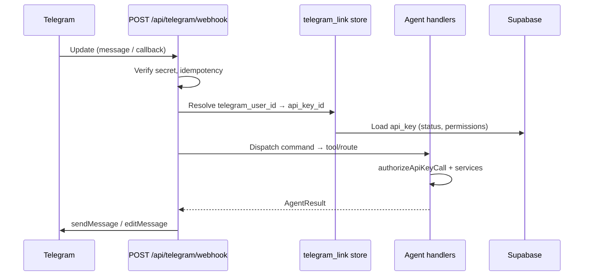

# Telegram bot bridge — feature plan

Let Matthew add and manage SimpleOutcome data from **Telegram** using the same agent surface as hosted MCP and REST: Bearer API keys, `authorizeApiKeyCall`, fail-closed grants, and the key owner’s user id as acting principal. Telegram is a **thin chat adapter** only — no parallel authz path.

**Repo:** [CoolColdUK/simpleOutcomeDev](https://github.com/CoolColdUK/simpleOutcomeDev)  
**Related:** [API keys, REST, and MCP](./api-mcp.md) (agent catalog and permission shape)  
**Hosting:** Vercel / Next.js App Router webhook route only. **No** local stdio MCP package.

This is a **plan / requirements** document. Locked decisions from Technical Forum are in **Decisions (locked)** below. Product code lands on **this PR branch** after plan approval (not a separate implementation PR by default).

---

## Goal

1. Users add the **one SimpleOutcome bot** (single BotFather app) and **DM it in private chat**.
2. **Link** (web-first): signed-in account settings → pick or create a scoped API key → single-use link token → `t.me/<bot>?start=<token>` or `/link <token>` → server stores `telegram_user_id` → `api_key_id` (**API secret never stored or sent in chat**).
3. Run **structured v1 commands** that call the **same** agent handlers as `POST /api/mcp` and `/api/...` REST.
4. **Revoke** the linked key (or unlink) → bot stops immediately (key validated every action, same as MCP).
5. Clear **deny** messages when grants, membership, or role matrix block an action.

**Not identity for linking:** SimpleOutcome **phone number** in profile settings. Telegram Bot API does not expose phone on every message; contact-share is out of v1. Primary key is **`message.from.id`** (`telegram_user_id`).

---

## Principles (must match existing product)

| Principle | Detail |
| --- | --- |
| Same agent surface | Bridge calls existing `*Agent*` functions (e.g. `listAgentTodoCards`, `createAgentTodoCard`) or a thin internal dispatcher that reuses `loadAgentContext` / `authorizeApiKeyCall` with the **linked key record**, not duplicated SQL. |
| Acting principal | Membership and role checks use **`ownerUserId`** on the linked API key, identical to MCP/REST. |
| Authz stack | Every action: **key valid** ∧ **live space/pod membership** ∧ **`featureKind` match** ∧ **key permission** (`pods`, `spaces`, `profile`) ∧ **role matrix** (`authorizeApiKeyCall` in `@so/model`). |
| Fail closed | Missing grant, revoked key, stale pod id, or role denial → user-visible Telegram reply with code + short message (mirror `ApiKeyAuthzCode` / agent error shapes where practical). |
| Hosted only | `POST /api/telegram/webhook` (name TBD) on production Vercel. Bot token and webhook secret in **server env**, never `NEXT_PUBLIC_*`. |
| No LLM in v1 | Structured commands and inline keyboards only. Free text gets a short hint to use commands; optional LLM → agent tools is **phase 2**. |
| One product bot | Single `TELEGRAM_BOT_TOKEN` for SimpleOutcome; all users DM the same bot. |
| No secrets in chat | Never ask users to paste a Bearer API key (or any secret) into Telegram. |

Permission storage shape (unchanged — bridge does not extend it):

```ts
{
  profile?: ApiKeyAction[]
  pods: { [podId]: { todo?: ApiKeyAction[]; fp?: ApiKeyFpGrant } }
  spaces: { [spaceId]: { space?: ApiKeyAction[]; group?: ApiKeyAction[] } }
}
```

Introspection for debugging in chat: call the same logic as **`get_api_key_permissions`** / `GET /api/api-keys/me` (effective rights after membership ∩ role matrix).

---

## Architecture (high level)



Linking uses a **one-time token** minted while the user is signed in on the web (like a password-reset URL). The server associates `telegram_user_id` with `api_key_id` only; the API key **plaintext secret is never stored** for the bridge and **never appears in Telegram messages**.

---

## 1. Linking / identity

### Product bot

- **One** BotFather bot for SimpleOutcome (production + staging may use separate bots operationally, but still one bot per environment).
- Users discover it via settings deep link and official docs; they **add the bot and open a private DM**.

### What gets linked

| Field | Purpose |
| --- | --- |
| `telegram_user_id` | Stable Telegram user id from `message.from.id` (primary identity). |
| `chat_id` | Where to send replies (DM: equals user id for private chats). |
| `owner_user_id` | SimpleOutcome user (must match API key `ownerUserId`). |
| `api_key_id` | FK to `public.api_key`; secret is **not** stored. |
| `linked_at`, `last_used_at` | Audit / support. |

### Link flow (web-first)

1. **Account settings** (new section on `AccountSettingsPage`, alongside `AccountApiKeysPanel`):
   - User selects an existing API key **or** creates one via **Connect Telegram** with the default **Telegram key preset** (see Decisions).
   - User taps **Connect Telegram** → server creates **`telegram_link_pending`**: high-entropy token, `api_key_id`, `owner_user_id`, `expires_at` (**15 minutes**), **single use**. Token is shown **only** in signed-in settings (treat like a password-reset URL).
2. UI shows deep link: `https://t.me/<BOT_USERNAME>?start=<token>`.
3. User opens the link or sends `/link <token>` in **private DM** only.
4. Webhook receives `/start <token>` or `/link <token>`:
   - Validate token (exists, not expired, not consumed).
   - **Refuse** if this `telegram_user_id` is already linked to a **different** `owner_user_id`.
   - Upsert **`telegram_link`**: one active link per **SimpleOutcome user**; relink from settings **replaces** the previous `telegram_user_id` (old id gets “linked elsewhere” on next message).
   - Mark pending token consumed.
   - Reply: success, key prefix, hint for `/help` and `/use`.

### API key choice

- User picks an existing scoped key **or** creates one in the Connect flow (session `auth.uid()` === owner only).
- **Never** paste or type an API key secret in Telegram; the bot must not accept or parse Bearer tokens from chat text.

### Family / shared spaces

- Acting principal is always the **API key owner** (same as MCP/REST). There is **no** shared bot principal.
- Each family member uses their **own** SimpleOutcome account, **own** link, and **own** API key scoped to what their role and grants allow.

### Unlink / revoke

| Action | Behavior |
| --- | --- |
| `/unlink` in Telegram | Delete `telegram_link` for this `telegram_user_id`; confirm in chat. |
| Revoke key in account settings | Next bot action fails closed (`revoked`); bot replies with link to settings. |
| Delete link in account settings | Same as unlink from web. |
| Key deleted (if ever supported) | CASCADE or app-level cleanup of links. |

Unlink does **not** revoke the API key unless the user does that separately.

### Security notes (linking)

- Pending tokens: single-use, **15 min TTL**, rate-limited per owner / IP.
- **Private DM only** for link and commands; ignore or refuse group/supergroup/channel updates (including `/start` with token).
- Refuse link when `telegram_user_id` already bound to another SO user.
- Log link events (owner, key prefix, telegram id hash) — no PII in public logs.

---

## 2. Chat surfaces (v1 vs phase 2)

### v1 scope: todo + thin context picker

**Context** (session state in DB or short-lived cache keyed by `telegram_link.id`):

- `active_space_id` (optional)
- `active_pod_id` (todo pod)

Commands are **structured** (Telegram bot commands + optional inline keyboards). Register the command menu with `/setMyCommands`. **No LLM in v1.**

**v1 command set (locked):** `/help`, `/status`, `/unlink`, `/pods`, `/use`, `/cards`, `/add`, `/done`.

| Command | Agent / REST equivalent | Grants needed |
| --- | --- | --- |
| `/help` | — | linked |
| `/status` | `get_api_key_permissions` | valid key |
| `/unlink` | delete `telegram_link` | linked |
| `/pods` | `list_space_pods` (todo pods the key may access; space context from grants) | todo **read** on pod or space **read** as needed |
| `/use <pod>` | sets `active_pod_id` | pod visible / granted |
| `/cards` [tag] | `list_todo_cards` | `pods[podId].todo` read |
| `/add <title>` | `create_todo_card` | todo create |
| `/done <card# or id prefix>` | `update_todo_card` with `completedAt` | todo update |

**Column for `/add`:** Default to the pod’s **default column** (product-defined default, e.g. first column by `sortOrder` if no explicit default). **Only** prompt (inline keyboard from `list_todo_columns`) when there is no default or the choice is ambiguous.

**Card identification:** Short id prefix + title in `/cards` output; ephemeral session maps `/done 1` to the last-listed card.

**Free text (non-commands):** Users may type arbitrary messages; v1 replies with a **short hint** to use `/help` or the command menu — no LLM, no tool dispatch.

**Complete card:** `update_todo_card` with `completedAt` (ISO UTC), same as MCP.

### Explicitly phase 2 (unless trivial during implementation)

| Area | MCP / REST tools (from [api-mcp.md](./api-mcp.md)) | Notes |
| --- | --- | --- |
| Financial planning | `list_fp_*`, `create_fp_transaction`, … | High complexity; not v1. |
| Profile | `get_profile`, `update_profile_*` | Low value in chat first. |
| Space / group admin | invites, member roles, `create_pod`, … | Dangerous from chat; defer. |
| Reorder / archive columns | `reorder_todo_*`, `archive_todo_column_*` | v1.1 if needed. |
| Card icons | `replace_todo_card_icon` | Needs file upload; defer. |
| Natural language / LLM | — | Phase 2: optional LLM maps free text → `MCP_TOOLS`; same `authorizeApiKeyCall` per call. |
| `/spaces`, `/columns`, `/comment`, extra todo affordances | — | Not required for v1; add in v1.1 if needed. |

---

## 3. Webhook endpoint and operations

### Route

- **`POST /api/telegram/webhook`** — receives Telegram `Update` JSON.
- Register webhook URL in Telegram: `https://<NEXT_PUBLIC_WEB_URL>/api/telegram/webhook` with `secret_token` (Bot API 6.x).

### Environment (Vercel / `packages/web/.env.local`)

| Variable | Purpose |
| --- | --- |
| `TELEGRAM_BOT_TOKEN` | From [@BotFather](https://t.me/BotFather); server-only. |
| `TELEGRAM_WEBHOOK_SECRET` | `X-Telegram-Bot-Api-Secret-Token` validation; reject mismatch **before** parsing body. |
| `TELEGRAM_BOT_USERNAME` | For deep links in settings UI (optional if derived via `getMe` once at deploy). |

Existing `SUPABASE_SECRET_KEY` remains required for agent DB access (same as `/api/mcp`).

### Update handling

| Concern | Approach |
| --- | --- |
| Auth to Telegram | Outbound `https://api.telegram.org/bot<token>/sendMessage` (or shared HTTP helper). |
| Update types | v1: `message` (commands) and `callback_query` (keyboards) in **private DM** only. **Ignore or refuse** group, supergroup, and channel updates (no link, no commands). |
| Idempotency | Store `telegram_update_id` (unique) for 24–48h; duplicate → `200 OK` no-op. |
| Ordering | Process single update per chat serially if needed (optional `chat_id` lock row). |
| Timeouts | Telegram expects fast `200`; heavy work should stay within Vercel function limits or defer (v1 keep calls synchronous for todo CRUD only). |
| GET on webhook | `405` or health stub — webhook is POST only. |

### Local development

- Tunnel (ngrok / cloudflared) → local Next dev, or use Telegram `setWebhook` against a preview deployment.
- Document in plan README section only; no separate worker service.

---

## 4. Authz (every action)

Bridge **must not** bypass `authorizeApiKeyCall`.

Recommended implementation shape:

1. Resolve `telegram_link` → load `ApiKeyRecord` + build `ApiKeyOwnerAccess` (reuse `loadAgentContext` helpers or extract `loadAgentContextForKeyId(apiKeyId)` used only server-side).
2. Map command to `ApiKeyCall` + invoke the same handler MCP uses via an **internal context loader by `api_key_id`** (reuse `loadAgentContext` / `authorizeApiKeyCall`). Do **not** reconstruct Bearer secrets from chat; plaintext secrets are not stored for links.

Deny messages (examples):

| Code | User-facing Telegram text |
| --- | --- |
| `revoked` | “This bot link uses a revoked API key. Create a new key and reconnect in Account settings.” |
| `forbidden` | “Not allowed: your key or role doesn’t permit this action on this pod.” |
| `not_found` | “Pod or card not found (or no longer accessible). Try `/pods`.” |
| `validation` | “Missing pod context. Use `/use <pod name>` first.” |

Use `get_api_key_permissions` output to drive `/status` and to populate `/pods` choices (only pods/spaces with **effective** read).

---

## 5. Out of scope

| Item | Decision |
| --- | --- |
| WhatsApp / Signal | Not this bridge; separate products/APIs. |
| Telegram Payments | No |
| Shopping pods | No agent surface today ([api-mcp.md](./api-mcp.md)) |
| Contact form | No |
| Group / supergroup / channel chats | **Out of v1** — ignore or refuse (DM-only surface) |
| Groups as shared “spaces” | No — not a product mapping |
| Phone number / contact share for link | No — identity is `telegram_user_id` only |
| Pasting API key or Bearer token in chat | **Forbidden** — not supported; never prompt for it |
| Streaming MCP / LLM chat over MCP | No |
| Local `packages/mcp` stdio | No |
| Minting API keys from Telegram without web session | No (v1) |

---

## 6. Data model (implementation sketch)

New tables (names illustrative):

- `telegram_link_pending` — token, `api_key_id`, `owner_user_id`, `expires_at`, `consumed_at`
- `telegram_link` — `owner_user_id` **unique** (one active link per SO user); `telegram_user_id` **unique** (one SO user per Telegram account); `chat_id`, `api_key_id`, context fields, timestamps
- `telegram_processed_update` — `update_id` bigint PK, `processed_at`

RLS: owners read/write their links via `auth.uid() = owner_user_id`; webhook uses **service role** only in route handler (same pattern as agent routes).

---

## 7. UI (account settings)

- Section **Telegram** under `/app/settings`:
  - Show linked Telegram hint (masked `telegram_user_id` / “Connected”).
  - **Connect Telegram:** pick pods → create or select API key → mint pending token → show deep link only while signed in.
  - **Default key preset (Connect flow):** on selected todo pods, grant **todo `read`, `create`, `update` only** — **not** `delete` unless the user expands permissions in the matrix (full todo CRUD is opt-in).
  - Disconnect / replace link (relink replaces prior Telegram account).
  - Which API key is bound (prefix + name); link to key editor.
- Copy: revoke key = bot stops; unlink = bot forgets chat only; **never put your API key in Telegram**.

No second key editor on space settings (consistent with [api-mcp.md](./api-mcp.md)).

---

## 8. Test plan (implementation checklist)

### Linking

- [ ] Pending token expires and cannot be reused.
- [ ] `/start <token>` links DM; invalid token friendly error.
- [ ] Relink replaces prior `telegram_user_id`; old account gets “linked elsewhere”.
- [ ] Link refused when `telegram_user_id` already tied to another SO user.
- [ ] Group message updates do not link or run commands.
- [ ] `/unlink` clears link; subsequent commands ask to link.
- [ ] Revoked key → next command fails with `revoked` message.
- [ ] Webhook rejects wrong `X-Telegram-Bot-Api-Secret-Token`.

### Authz (reuse / extend `authorizeApiKeyCall` tests patterns)

- [ ] Todo create with grant succeeds; without `create` on `pods[podId].todo` fails.
- [ ] Pod A grant cannot mutate pod B.
- [ ] Role matrix denial surfaces clear message.
- [ ] `get_api_key_permissions` / `/status` matches MCP for same key.

### Todo commands

- [ ] `/pods` lists only permitted todo pods.
- [ ] `/add` uses default column; keyboard only when ambiguous.
- [ ] `/add` creates card identical to MCP `create_todo_card` (same validation).
- [ ] Non-command free text returns command hint (no LLM).
- [ ] `/done` sets `completedAt` via `update_todo_card`.
- [ ] `/cards` pagination or limit (Telegram message length).

### Webhook robustness

- [ ] Duplicate `update_id` ignored.
- [ ] Malformed update → `200` where required to avoid retry storms; log server-side.

### Package tests

- [ ] Any new **exported** helpers in `@so/model` (e.g. command → `ApiKeyCall` mapper) have unit tests per repo rules.

---

## 9. Risks

| Risk | Mitigation |
| --- | --- |
| **Bot token leakage** | Server env only; never log token; rotate via BotFather; least-privilege Vercel env. |
| **Spoofed Telegram user id** | Do not trust client-supplied ids; only ids from signed webhook payload after secret validation. |
| **Webhook secret brute force** | Long random secret; constant-time compare; rate limit IP. |
| **Link token phishing** | Short TTL, single use, bind to `owner_user_id` at mint time. |
| **Stolen phone / Telegram session** | Attacker acts within API key grants — same as stolen MCP key; recommend dedicated scoped key + revoke. |
| **Telegram rate limits** | Batch/list limits; chunk long lists; backoff on 429. |
| **Message length** | Split replies; avoid dumping huge JSON. |
| **Group privacy** | v1 is DM-only; group updates refused/ignored. |
| **API key pasted in chat** | Bot does not parse secrets; users link only via web token. |

---

## 10. Decisions (locked)

Technical Forum — not open for re-litigation in v1 unless explicitly reopened.

| # | Decision |
| --- | --- |
| 1 | **Chat surface:** v1 = **private DMs only**. Ignore or refuse group/supergroup/channel link and commands. |
| 2 | **One product bot** — single BotFather bot for SimpleOutcome; users add it and DM it. |
| 3 | **Identity:** Primary key is Telegram `message.from.id` (`telegram_user_id`). **Not** SO phone number. Linking is web-first: signed-in Account settings → scoped API key → single-use short-TTL token → `t.me/<bot>?start=<token>` or `/link <token>` → upsert `telegram_user_id` → `api_key_id` (secret never stored). |
| 4 | **No API key in chat.** Never ask users to paste a Bearer key into Telegram. |
| 5 | **Link cardinality:** One active Telegram link per SO user; relink **replaces** the previous `telegram_user_id`. No multiple Telegram devices per SO user in v1. |
| 6 | **Principal / family:** Always the **API key owner** (same as MCP/REST). No shared bot principal. Each person: own SO account, own link, own key. |
| 7 | **Link token security:** ~15 min TTL, single use, shown only in signed-in settings. Refuse if `telegram_user_id` already linked to a **different** SO user. Treat deep link like a password-reset URL. |
| 8 | **v1 commands:** `/help`, `/status`, `/unlink`, `/pods`, `/use`, `/cards`, `/add`, `/done`. Column for `/add`: pod **default column**; prompt only when ambiguous. Register bot command menu. |
| 9 | **Natural language:** **Not in v1.** Phase 2 optional LLM → same agent tools. Free text in v1 gets a command hint only. |
| 10 | **Telegram key preset (Connect flow):** Default = todo **read + create + update** on selected pods; **delete** and full CRUD only if user expands in the matrix. |

---

## Success

Plan approved on the PR. Implementation on the **same branch** delivers a hosted Telegram webhook (one bot, DM-only) that links SO users via web token to an API key id and performs v1 todo commands through the **same** agent layer as `POST /api/mcp` and `/api/pods/{podId}/todo/...` REST, with fail-closed `authorizeApiKeyCall` and revocable access.
