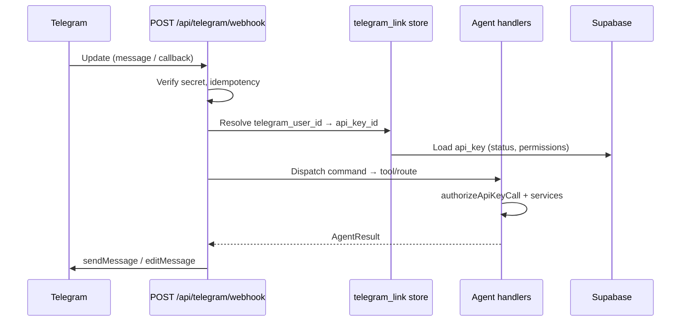

# Telegram bot bridge — feature plan

Let Matthew add and manage SimpleOutcome data from **Telegram** using the same agent surface as hosted MCP and REST: Bearer API keys, `authorizeApiKeyCall`, fail-closed grants, and the key owner’s user id as acting principal. Telegram is a **thin chat adapter** only — no parallel authz path.

**Repo:** [CoolColdUK/simpleOutcomeDev](https://github.com/CoolColdUK/simpleOutcomeDev)  
**Related:** [API keys, REST, and MCP](./api-mcp.md) (agent catalog and permission shape)  
**Hosting:** Vercel / Next.js App Router webhook route only. **No** local stdio MCP package.

This is a **plan / requirements** document. Product code waits until Matthew approves this plan on the implementation PR branch, then lands on **that same branch** (not a separate implementation PR by default).

---

## Goal

1. Matthew (and other users) can **link** a Telegram account to their SimpleOutcome user and a **dedicated API key**.
2. From Telegram (v1: **DMs** with the bot), run **structured commands** that call the **same** agent handlers as `POST /api/mcp` and `/api/...` REST.
3. **Revoke** the linked key (or unlink) → bot stops acting for that user immediately (key checked every action, same as MCP).
4. Clear **deny** messages when grants, membership, or role matrix block an action.

---

## Principles (must match existing product)

| Principle | Detail |
| --- | --- |
| Same agent surface | Bridge calls existing `*Agent*` functions (e.g. `listAgentTodoCards`, `createAgentTodoCard`) or a thin internal dispatcher that reuses `loadAgentContext` / `authorizeApiKeyCall` with the **linked key record**, not duplicated SQL. |
| Acting principal | Membership and role checks use **`ownerUserId`** on the linked API key, identical to MCP/REST. |
| Authz stack | Every action: **key valid** ∧ **live space/pod membership** ∧ **`featureKind` match** ∧ **key permission** (`pods`, `spaces`, `profile`) ∧ **role matrix** (`authorizeApiKeyCall` in `@so/model`). |
| Fail closed | Missing grant, revoked key, stale pod id, or role denial → user-visible Telegram reply with code + short message (mirror `ApiKeyAuthzCode` / agent error shapes where practical). |
| Hosted only | `POST /api/telegram/webhook` (name TBD) on production Vercel. Bot token and webhook secret in **server env**, never `NEXT_PUBLIC_*`. |
| No LLM required for v1 | Structured commands and inline keyboards; optional natural-language layer is **phase 2**. |

Permission storage shape (unchanged — bridge does not extend it):

```ts
{
  profile?: ApiKeyAction[]
  pods: { [podId]: { todo?: ApiKeyAction[]; fp?: ApiKeyFpGrant } }
  spaces: { [spaceId]: { space?: ApiKeyAction[]; group?: ApiKeyAction[] } }
}
```

Introspection for debugging in chat: call the same logic as **`get_api_key_permissions`** / `GET /api/api-keys/me` (effective rights after membership ∩ role matrix).

---

## Architecture (high level)



Telegram never holds the long-lived API secret in chat after link completes. Linking uses a **one-time token** minted while the user is signed in on the web; the server associates `telegram_user_id` (and optionally `chat_id`) with `api_key_id`.

---

## 1. Linking / identity

### What gets linked

| Field | Purpose |
| --- | --- |
| `telegram_user_id` | Stable Telegram user id from `message.from.id` (primary identity). |
| `chat_id` | Where to send replies (DM: equals user id for private chats). |
| `owner_user_id` | SimpleOutcome user (must match API key `ownerUserId`). |
| `api_key_id` | FK to `public.api_key`; secret is **not** stored. |
| `linked_at`, `last_used_at` | Audit / support. |

Optional: `label` (user-chosen name for “this Telegram device”).

### Link flow (recommended)

1. **Account settings** (new section on `AccountSettingsPage`, alongside `AccountApiKeysPanel`):
   - User selects an existing API key **or** creates a new key with a suggested name (e.g. “Telegram”) and a **Telegram-friendly preset** (todo read/write on chosen pods — details in UI section).
   - User taps **Connect Telegram** → server creates **`telegram_link_pending`** row: random high-entropy token, `api_key_id`, `owner_user_id`, `expires_at` (e.g. 15 minutes), single use.
2. UI shows:
   - Deep link: `https://t.me/<BOT_USERNAME>?start=<token>` (Telegram passes token to `/start` payload).
   - Fallback: user sends `/link <token>` to the bot in DM.
3. Webhook receives `/start <token>` or `/link <token>`:
   - Validate token (exists, not expired, not consumed).
   - Upsert **`telegram_link`** for this `telegram_user_id` (see multi-device below).
   - Mark pending token consumed.
   - Reply: success, current context (key prefix, effective pod count), hint for `/help`.

### API key choice

- **Preferred:** User picks or creates a **scoped** key in account settings (principle of least privilege for chat).
- **Allowed:** “Use existing key” if user already has one with the right grants.
- Bridge **must not** mint arbitrary keys without a signed-in session; optional future: “create Telegram key” server action only when session `auth.uid()` === owner.

### Multi-device

- **Default (v1):** One active link per **SimpleOutcome user** → linking from a second Telegram account **replaces** the previous link (old `telegram_user_id` gets “account linked elsewhere” on next message).
- **Alternative (if Matthew wants):** One link per `telegram_user_id`, multiple Telegram users per SO account — document choice in PR approval.

### Unlink / revoke

| Action | Behavior |
| --- | --- |
| `/unlink` in Telegram | Delete `telegram_link` for this `telegram_user_id`; confirm in chat. |
| Revoke key in account settings | Next bot action fails closed (`revoked`); bot replies with link to settings. |
| Delete link in account settings | Same as unlink from web. |
| Key deleted (if ever supported) | CASCADE or app-level cleanup of links. |

Unlink does **not** revoke the API key unless the user does that separately.

### Security notes (linking)

- Pending tokens: single-use, short TTL, rate-limited per user IP / per owner.
- Bind `/start` handler to **DM only** in v1 (ignore or refuse group `/start` with token).
- Log link events (owner, key prefix, telegram id hash) — no PII in public logs.

---

## 2. Chat surfaces (v1 vs phase 2)

### v1 scope: todo + thin context picker

**Context** (session state in DB or short-lived cache keyed by `telegram_link.id`):

- `active_space_id` (optional)
- `active_pod_id` (todo pod)

Commands are **structured** (Telegram bot commands + optional inline keyboards). No LLM.

| Command / UX | Agent / REST equivalent | Grants needed |
| --- | --- | --- |
| `/help` | — | — |
| `/status` | `get_api_key_permissions` | valid key |
| `/spaces` | `list_spaces` | key (space list uses granted spaces) |
| `/pods` or `/pods <space>` | `list_space_pods` | `spaces[spaceId].space` **read** (or pod grant on that space) |
| `/use <pod>` | sets context | pod visible via `list_space_pods` / grants |
| `/columns` | `list_todo_columns` | `pods[podId].todo` read |
| `/cards` [tag] | `list_todo_cards` | todo read |
| `/add <title>` | `create_todo_card` (default column: first column or last-used) | todo create |
| `/done <card# or id prefix>` | `update_todo_card` with `completedAt` | todo update |
| `/card <id>` | read single card via list filter or future get | todo read |
| `/comment <card> <text>` | `create_todo_comment` | todo create on comment resource |

**Column picking for `/add`:** v1 may use first column by `sortOrder`, or reply with inline keyboard listing columns (`list_todo_columns`) when ambiguous.

**Card identification:** Prefer short id prefix + title hint in list output; store last-listed mapping in ephemeral session to resolve `/done 1`.

**Complete card:** `update_todo_card` with `completedAt` set (ISO UTC), same as MCP.

### Explicitly phase 2 (unless trivial during implementation)

| Area | MCP / REST tools (from [api-mcp.md](./api-mcp.md)) | Notes |
| --- | --- | --- |
| Financial planning | `list_fp_*`, `create_fp_transaction`, … | High complexity; not v1. |
| Profile | `get_profile`, `update_profile_*` | Low value in chat first. |
| Space / group admin | invites, member roles, `create_pod`, … | Dangerous from chat; defer. |
| Reorder / archive columns | `reorder_todo_*`, `archive_todo_column_*` | v1.1 if needed. |
| Card icons | `replace_todo_card_icon` | Needs file upload; defer. |
| Natural language | — | Optional LLM maps utterance → tool call; **not** required for v1. |

### Commands vs natural language

- **v1:** Bot command menu registered with Telegram (`/setMyCommands`). Parsing is deterministic.
- **Later:** Optional “free text” mode calling an LLM with tool schemas from `MCP_TOOLS` — same `authorizeApiKeyCall` per invoked tool.

---

## 3. Webhook endpoint and operations

### Route

- **`POST /api/telegram/webhook`** — receives Telegram `Update` JSON.
- Register webhook URL in Telegram: `https://<NEXT_PUBLIC_WEB_URL>/api/telegram/webhook` with `secret_token` (Bot API 6.x).

### Environment (Vercel / `packages/web/.env.local`)

| Variable | Purpose |
| --- | --- |
| `TELEGRAM_BOT_TOKEN` | From [@BotFather](https://t.me/BotFather); server-only. |
| `TELEGRAM_WEBHOOK_SECRET` | `X-Telegram-Bot-Api-Secret-Token` validation; reject mismatch **before** parsing body. |
| `TELEGRAM_BOT_USERNAME` | For deep links in settings UI (optional if derived via `getMe` once at deploy). |

Existing `SUPABASE_SECRET_KEY` remains required for agent DB access (same as `/api/mcp`).

### Update handling

| Concern | Approach |
| --- | --- |
| Auth to Telegram | Outbound `https://api.telegram.org/bot<token>/sendMessage` (or shared HTTP helper). |
| Update types | v1: `message` (commands), `callback_query` (inline keyboards). Ignore channels; **groups** per open question below. |
| Idempotency | Store `telegram_update_id` (unique) for 24–48h; duplicate → `200 OK` no-op. |
| Ordering | Process single update per chat serially if needed (optional `chat_id` lock row). |
| Timeouts | Telegram expects fast `200`; heavy work should stay within Vercel function limits or defer (v1 keep calls synchronous for todo CRUD only). |
| GET on webhook | `405` or health stub — webhook is POST only. |

### Local development

- Tunnel (ngrok / cloudflared) → local Next dev, or use Telegram `setWebhook` against a preview deployment.
- Document in plan README section only; no separate worker service.

---

## 4. Authz (every action)

Bridge **must not** bypass `authorizeApiKeyCall`.

Recommended implementation shape:

1. Resolve `telegram_link` → load `ApiKeyRecord` + build `ApiKeyOwnerAccess` (reuse `loadAgentContext` helpers or extract `loadAgentContextForKeyId(apiKeyId)` used only server-side).
2. Map command to `ApiKeyCall` + invoke the same handler MCP uses (e.g. `listAgentTodoCards(request, args)` with a **synthetic Request** carrying `Authorization: Bearer <key>` **or** internal entry that accepts pre-loaded context — prefer one code path; if synthetic Bearer is used, load plaintext secret is **not** available; **internal context loader by key id** is required).

Deny messages (examples):

| Code | User-facing Telegram text |
| --- | --- |
| `revoked` | “This bot link uses a revoked API key. Create a new key and reconnect in Account settings.” |
| `forbidden` | “Not allowed: your key or role doesn’t permit this action on this pod.” |
| `not_found` | “Pod or card not found (or no longer accessible). Try `/pods`.” |
| `validation` | “Missing pod context. Use `/use <pod name>` first.” |

Use `get_api_key_permissions` output to drive `/status` and to populate `/pods` choices (only pods/spaces with **effective** read).

---

## 5. Out of scope

| Item | Decision |
| --- | --- |
| WhatsApp / Signal | Not this bridge; separate products/APIs. |
| Telegram Payments | No |
| Shopping pods | No agent surface today ([api-mcp.md](./api-mcp.md)) |
| Contact form | No |
| Groups as shared “spaces” | **Parked** — see open questions (DM-first for v1) |
| Group chats where bot is added | **Parked** — likely ignore or read-only announce in v1 |
| Streaming MCP / LLM chat over MCP | No |
| Local `packages/mcp` stdio | No |
| Minting API keys from Telegram without web session | No (v1) |

---

## 6. Data model (implementation sketch)

New tables (names illustrative):

- `telegram_link_pending` — token, `api_key_id`, `owner_user_id`, `expires_at`, `consumed_at`
- `telegram_link` — `telegram_user_id` (unique per policy), `chat_id`, `api_key_id`, `owner_user_id`, context fields, timestamps
- `telegram_processed_update` — `update_id` bigint PK, `processed_at`

RLS: owners read/write their links via `auth.uid() = owner_user_id`; webhook uses **service role** only in route handler (same pattern as agent routes).

---

## 7. UI (account settings)

- Section **Telegram** under `/app/settings`:
  - Show linked Telegram hint (masked id / “Connected”).
  - Connect flow (pending link + deep link).
  - Disconnect.
  - Which API key is bound (prefix + name); link to key editor.
- Copy: revoke key = bot stops; unlink = bot forgets chat only.

No second key editor on space settings (consistent with [api-mcp.md](./api-mcp.md)).

---

## 8. Test plan (implementation checklist)

### Linking

- [ ] Pending token expires and cannot be reused.
- [ ] `/start <token>` links DM; invalid token friendly error.
- [ ] Second link replaces first (per chosen multi-device policy).
- [ ] `/unlink` clears link; subsequent commands ask to link.
- [ ] Revoked key → next command fails with `revoked` message.
- [ ] Webhook rejects wrong `X-Telegram-Bot-Api-Secret-Token`.

### Authz (reuse / extend `authorizeApiKeyCall` tests patterns)

- [ ] Todo create with grant succeeds; without `create` on `pods[podId].todo` fails.
- [ ] Pod A grant cannot mutate pod B.
- [ ] Role matrix denial surfaces clear message.
- [ ] `get_api_key_permissions` / `/status` matches MCP for same key.

### Todo commands

- [ ] `/pods` lists only permitted todo pods.
- [ ] `/add` creates card identical to MCP `create_todo_card` (same validation).
- [ ] `/done` sets `completedAt` via `update_todo_card`.
- [ ] `/cards` pagination or limit (Telegram message length).

### Webhook robustness

- [ ] Duplicate `update_id` ignored.
- [ ] Malformed update → `200` where required to avoid retry storms; log server-side.

### Package tests

- [ ] Any new **exported** helpers in `@so/model` (e.g. command → `ApiKeyCall` mapper) have unit tests per repo rules.

---

## 9. Risks

| Risk | Mitigation |
| --- | --- |
| **Bot token leakage** | Server env only; never log token; rotate via BotFather; least-privilege Vercel env. |
| **Spoofed Telegram user id** | Do not trust client-supplied ids; only ids from signed webhook payload after secret validation. |
| **Webhook secret brute force** | Long random secret; constant-time compare; rate limit IP. |
| **Link token phishing** | Short TTL, single use, bind to `owner_user_id` at mint time. |
| **Stolen phone / Telegram session** | Attacker acts within API key grants — same as stolen MCP key; recommend dedicated scoped key + revoke. |
| **Telegram rate limits** | Batch/list limits; chunk long lists; backoff on 429. |
| **Message length** | Split replies; avoid dumping huge JSON. |
| **Group privacy** | DM-first avoids cross-user leakage in group threads. |

---

## 10. Open questions (for Matthew)

1. **DM only vs group chats for v1?** Recommendation: **private DM only**; ignore group messages except maybe “please message me privately to link”.
2. **Multi-device:** One Telegram account per SO user (replace on relink) vs multiple Telegram links per SO user?
3. **v1 command set:** Is `/add` + `/done` + `/cards` + `/pods` enough, or require column picker on every add?
4. **Default key preset for “Telegram” key:** All read on granted pods + todo create/update only, or full todo CRUD?
5. **Bot display name / username** — product branding (operational, not blocking).

---

## Success

Matthew approves this plan on the PR. Implementation on the **same branch** delivers a hosted Telegram webhook that links SO users to an API key and performs v1 todo management through the **same** agent layer as `POST /api/mcp` and `/api/pods/{podId}/todo/...` REST, with fail-closed `authorizeApiKeyCall` and revocable access.
