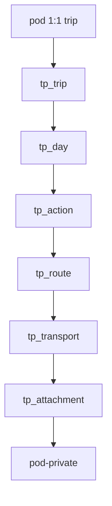

# In-app trip planning — feature plan

Stippl-inspired **day-by-day itineraries** inside SimpleOutcome: each **day** holds ordered **actions** (travel, stay, activity, note). **Travel** actions support alternative **routes** (e.g. coach vs train), each route an ordered chain of **transports** (multi-modal). Optional **budget**, **costs**, and **attachments** (images + PDF on transports only) — without map tiles, booking marketplaces, or affiliate clutter in v1.

**Repo:** [CoolColdUK/simpleOutcomeDev](https://github.com/CoolColdUK/simpleOutcomeDev)  
**Related:** [API keys, REST, and MCP](./api-mcp.md) (agent surface — trip tools are **phase 2**), [Telegram bot bridge](https://github.com/CoolColdUK/simpleOutcomeDev/blob/cursor/telegram-bridge-plan-f6f2/plan/feature/telegram-bridge.md) (separate track; ships **before** this feature)

**Product positioning:** In-app SimpleOutcome feature (web UI first). Not external Travel assistant bots.

This is a **plan / requirements** document. Product code waits until Matthew approves this plan on the implementation PR branch, then lands on **that same branch**.

---

## Sequencing (Matthew’s queue)

| Order | Track | Notes |
| --- | --- | --- |
| 1 | [Telegram bridge](https://github.com/CoolColdUK/simpleOutcomeDev/blob/cursor/telegram-bridge-plan-f6f2/plan/feature/telegram-bridge.md) | Ships before trip planning. |
| 2 | **Trip planning (this plan)** | `trip_planning` pod kind; day → action model. |
| 3 | Agent surface (optional) | REST / MCP after in-app v1 — extend [api-mcp.md](./api-mcp.md). |
| 4 | Cross-feature links (optional) | Soft links to **todo** / **financial planning** — phase 2. |

Do not fold trip planning into the Telegram PR.

---

## Decisions (locked)

Matthew confirmed in Technical Forum (Oct 2026). Do not re-litigate without a new decision.

| # | Topic | Decision |
| --- | --- | --- |
| 1 | **Cardinality** | **One trip per pod.** No trip list inside a pod. |
| 2 | **Multi-city** | **Yes in v1** — ordered `primary_destinations` text; no routing engine. |
| 3 | **Authz** | **Pod roles** only. Repo today has `pod_owner` / `pod_admin` / `pod_user` only — **add `pod_viewer`** platform-wide (slice 0). Viewers read itinerary + download attachments; no writes/uploads. |
| 4 | **Costs / budget** | **Yes in v1** — trip-level budget; optional costs on **actions** (stay/activity/note) and on each **transport**; travel action rollup uses **selected route** transports. |
| 5 | **Core itinerary model** | **Day → ordered actions.** Kinds: `travel`, `stay`, `activity`, `note`. **Travel:** action → one or more alternative **routes** → ordered **transports** (multi-modal per route). Mark one route **selected** per travel action. **No** day-level alternative-group table; **no** trip-level whole-journey travel plan in v1 (compare journeys at **action** scope only). |
| 6 | **Multi-day transport** | Transports use `depart_at` / `arrive_at` (timestamptz) and may cross calendar days. **UX:** travel action **listed on departure day**; card shows span text (“Arrives next day”, “Overnight”, “+2 days”). **Arrival day:** show a **read-only reference** row (“In transit from …” / link to travel action) — no duplicate editing surface. |
| 7 | **Attachments** | **v1:** **images + PDF only** (`image/jpeg`, `image/png`, `application/pdf`). Attach to **`tp_transport` only** (ticket on the specific segment). Reuse **`pod-private`**, **5 MB** file limit (existing bucket). Trip/day-level file dump → **phase 2**. |
| 8 | **Cross-feature** | Todo / FP soft links → **phase 2**. |
| 9 | **Map / bookings** | No map SDK; no booking marketplaces. |
| 10 | **Travellers** | Multiple named travellers → **later**. |

**Engineering defaults:** leg times stored UTC; day boundaries use trip `timezone`. Shortening trip dates with content on removed days → confirm before `syncTpDaysForTrip`.

### Superseded (do not implement in v1)

| Previous plan idea | Replacement |
| --- | --- |
| `tp_item` + `tp_alternative_group` + `tp_travel_leg` | `tp_action` + `tp_route` + `tp_transport` |
| Trip-level `tp_travel_plan` (whole-journey compare) | **Out of v1** — optional phase 2 if Matthew wants cross-day journey templates |
| Attachments on trip / day / action | **Transport only** in v1 |

---

## Goal

1. **Top-down:** create `trip_planning` pod → dates + **multi-city** destinations → fill each **day** with **actions**.
2. **List / timeline-first** (day strip + action cards). Places as **text** + optional maps URL — **no map SDK**.
3. **Travel** actions: add alternative **routes**, each with sequential **transports**; pick a **selected** route.
4. **Share** via space/pod membership; **`pod_viewer`** for read-only.
5. **Budget** + line costs; **PDF/image** tickets on transports.
6. No booking engines or affiliate UI.

---

## Principles

| Principle | Detail |
| --- | --- |
| Day → action | The day timeline is an ordered list of actions, not a flat mix of items and separate OR widgets. |
| Travel = routes × transports | Alternatives are **routes** under one travel action; each route is a **sequence** of transports. |
| One trip per pod | Opening the pod opens the single itinerary. |
| Multi-day honesty | Long-haul shows real dep/arr times; span copy on the card; ghost reference on arrival day. |
| Transport = attachment target | Booking PDFs bind to the segment they belong to. |
| Platform `pod_viewer` | Added for all pod kinds; trip is first feature that **needs** view-only sharing. |
| Storage reuse | [`pod-private`](packages/model/src/todo/constants.ts) + todo-style upload helpers. |
| Telegram / agents later | Product UI first. |

---

## Inspiration vs out of scope (v1)

| In | Out of v1 |
| --- | --- |
| Day-by-day actions, multi-city text | Map SDK, route maps |
| Route alternatives + multi-modal transports | Trip-level “Plan A vs Plan B” journey compare |
| Budget + transport/action costs | Booking marketplaces |
| Image/PDF on **transport** | Attachments on trip/day; trip file dump (**phase 2**) |
| `pod_viewer` sharing | Per-traveller profiles, Telegram trip commands |
| | Soft todo/FP links (**phase 2**) |
| | AI trip generation |

---

## Product context

### Where it lives

- **`FeatureKind.TRIP_PLANNING = 'trip_planning'`** on `pod`.
- **One `tp_trip` per pod** (`unique (pod_id)`).
- Wizard on pod create (or first open).

### Membership and roles

**Today:** [`PodRole`](packages/model/src/space/podRole.ts) has no viewer; `pod_member.role_check` allows three roles only.

**Add `pod_viewer`:** read trip + signed attachment URLs; no mutations. Editors use `pod_user` / `pod_admin` / `pod_owner`. Update member RPCs, labels, todo/fp/trip RLS and storage policies (slice 0).

---

## Core objects (schema sketch)

Prefix `tp_*`. RLS: `app_private.tp_can(pod_id, read|write|manage_settings)`.

### Trip (`tp_trip`)

| Column | Notes |
| --- | --- |
| `pod_id` | **unique** FK |
| `title`, `timezone` | |
| `start_date`, `end_date` | Inclusive |
| `primary_destinations` | `text[]`, ordered multi-city |
| `status` | `draft` \| `active` \| `done` \| `archived` |
| `budget_amount`, `budget_currency` | Optional |
| `maps_url`, `notes` | Optional |

### Day (`tp_day`)

| Column | Notes |
| --- | --- |
| `trip_id`, `day_index`, `calendar_date` | |
| `label`, `notes` | Optional |

Synced when trip dates change.

### Action (`tp_action`)

Ordered within a day (or **ideas** when `day_id` is null).

| Column | Notes |
| --- | --- |
| `trip_id` | FK |
| `day_id` | Nullable → ideas bucket |
| `kind` | `travel` \| `stay` \| `activity` \| `note` |
| `title` | Required |
| `place_text`, `maps_url` | Optional text place |
| `start_time`, `end_time` | Optional **local** times for non-travel (same calendar day) |
| `cost_amount`, `cost_currency` | Optional on **stay / activity / note** |
| `booking_ref`, `url`, `notes` | Optional |
| `selected_route_id` | Nullable; only for `kind = travel` — which route counts for budget/display |
| `sort_order` | Within day (or ideas list) |

**Travel actions** do not store transport rows directly; they own `tp_route` children.

### Route (`tp_route`)

Alternative way to complete a **travel** action (e.g. “Via coach” vs “Via train + taxi”).

| Column | Notes |
| --- | --- |
| `action_id` | FK → `tp_action` where `kind = travel` |
| `name` | Short label |
| `is_selected` | At most one `true` per `action_id` (app + DB guard) |
| `notes`, `sort_order` | |

`selected_route_id` on the action should stay in sync with `is_selected` (single source of truth: prefer **action.selected_route_id** with route `is_selected` derived in reads, or trigger — pick one in implementation).

### Transport (`tp_transport`)

One **segment** within a route (former “leg”). Ordered multi-modal chain.

| Column | Notes |
| --- | --- |
| `route_id` | FK → `tp_route` |
| `mode` | `flight` \| `train` \| `coach` \| `bus` \| `car` \| `ferry` \| `walk` \| `other` |
| `from_text`, `to_text` | |
| `depart_at`, `arrive_at` | **timestamptz**; may span days |
| `cost_amount`, `cost_currency` | Optional |
| `booking_ref`, `url`, `notes` | |
| `sort_order` | Within route |

**Attachments** hang off `transport_id` only (see below).

### Day reference (`tp_action_day_ref`) — optional table vs computed

For **arrival-day ghosts** without duplicating the travel action:

| Approach | Detail |
| --- | --- |
| **Recommended** | No extra row: UI derives ghosts by scanning transports whose `arrive_at` (in trip TZ) falls on a day **≠** action’s `day_id` (departure day). Render read-only chip on those days linking to the travel action. |
| Fallback | `tp_action_day_ref(action_id, day_id, ref_kind: 'arrival_ghost')` if queries need indexing — only if perf requires. |

**Locked UX:** editable travel action appears **only** on **departure day** (`action.day_id` = calendar date of first transport’s `depart_at` in trip TZ, enforced on save).

### Pod settings (`tp_setting`)

| Column | Notes |
| --- | --- |
| `pod_id` | 1:1 |
| `default_currency` | For budget/cost fields |

### Attachments (`tp_attachment`) — v1

| Column | Notes |
| --- | --- |
| `transport_id` | FK → `tp_transport`, on delete cascade |
| `pod_id`, `trip_id` | Denormalized for RLS |
| `storage_path` | `pod-private` key |
| `file_name`, `mime_type`, `byte_size` | |
| `uploaded_by`, `created_at` | |

**MIME (locked):** `image/jpeg`, `image/png`, `application/pdf` only — migration extends `storage.buckets.allowed_mime_types` (drop webp from earlier draft).

**Path:** `{pod_id}/tp/transport/{transport_id}/{attachment_id}-{safe_filename}`

**Limits:** **5 MB** per file (bucket default); cap e.g. **10 files per transport** (`@so/model` constant).

**Authz:** write = non-viewer pod member with `tp_can` write; read = any member including viewer → signed URL.

### Budget rollup (v1)

| Source | Included when |
| --- | --- |
| `stay` / `activity` / `note` actions | `cost_*` on action (scheduled days; ideas optional toggle in UI) |
| `travel` actions | Sum `cost_*` on all transports of **`selected_route_id`** (if none selected, travel contributes 0 + UI warning) |
| Total vs `tp_trip.budget_amount` | Header or Budget panel; no FX |

---

## UX (v1)

### 1. Create pod / trip wizard

When + multi-city where + title + timezone + optional budget → `tp_trip` + `tp_day` rows → land on day 1.

### 2. Day timeline

- Day strip; **ordered action cards** per day.
- **+ Add action** → pick kind.
- **Stay / activity / note:** title, place, times, cost, refs — single card.
- **Travel:** card shows route tabs or stacked alternatives; expand route → ordered **transports** list; add/remove/reorder transports; mark **selected route**.
- **Multi-day:** first transport `depart_at` sets departure day anchor; card subtitle shows arrival date/time and “overnight” / “+N days” when `arrive_at` crosses midnight in trip TZ.
- **Arrival day:** ghost row (read-only) pointing to the travel action — user does not edit transports from ghost.
- **Ideas:** actions with no `day_id`.

### 3. Attachments

- Upload control **on each transport** row (image/PDF); list + download; delete for editors.
- No upload on trip, day, or non-travel action in v1.

### 4. Budget

- Trip budget in header/settings; costs on actions/transports; rollup vs budget.

### 5. Sharing

- Space + pod membership; assign **`pod_viewer`**.

### 6. Visual

- No map SDK; optional external link on place text.
- Route comparison: side-by-side or tabs with total duration/cost hint from transports.

---

## Implementation sketch

Pattern: [financial planning implementation](./financial%20planning-implementation.md).

### Suggested slices

| Slice | Deliverable |
| --- | --- |
| **0** | **`pod_viewer`** platform-wide (migration, `PodRole`, RPCs, UI picker, read-only storage/todo/fp/trip) |
| A | `FeatureKind.TRIP_PLANNING`; `tp_setting`; `tp_trip` + `tp_day`; wizard; day strip shell |
| B | `tp_action` — `stay`, `activity`, `note`; ideas; reorder; action costs |
| C | `tp_route` + `tp_transport`; travel action UI; route select; multi-modal ordering |
| D | Multi-day span copy + arrival-day **ghost** derivation; validate departure-day anchor |
| E | Budget rollup UI; trip status/archive |
| F | `tp_attachment` + bucket MIME (jpeg/png/pdf) + transport upload/download |

### Services (names illustrative)

- `syncTpDaysForTrip`
- `{action}DbTpTrip`, `DbTpDay`, `DbTpAction`, `DbTpRoute`, `DbTpTransport`, `DbTpAttachment`
- `uploadStorageTpTransportAttachment`, signed URL helpers
- `@so/model`: `tpBudgetRollup`, `tpTransportSpansDays`, ghost-day helper — **unit tests**

### REST / MCP

After in-app v1; tool names align to action/route/transport (`list_tp_actions`, …). Attachment upload optional in agent v1.

### Phase 2 (not v1)

- Trip-level attachment library / zip dump
- Trip-level whole-journey plan compare (`tp_travel_plan` style)
- Soft links todo / FP
- Telegram / AI trip features

---

## Success criteria

- Plan reflects **day → action → route → transport**, **transport-only** attachments (image/PDF), **no** trip-level travel plans in v1, plus prior locks: one trip/pod, multi-city, `pod_viewer`, budget, Telegram-first, map-free.
- Slices **0** + **A** are unambiguous for implementation.

---

## Approval

Matthew: **approve** on the PR. Implementation on **`cursor/trip-planning-plan-bd93`** unless you choose another branch name.
