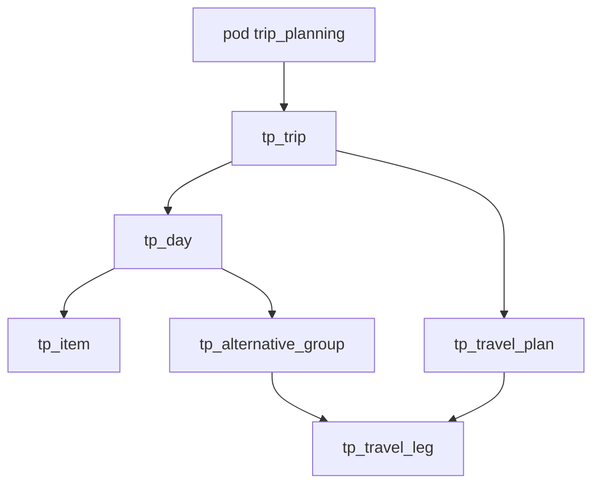

# In-app trip planning — feature plan

Stippl-inspired **day-by-day itineraries** inside SimpleOutcome: destinations, stays, activities, meals, notes, and **multiple alternative travel plans** — without slow map tiles, booking marketplaces, or affiliate clutter in v1.

**Repo:** [CoolColdUK/simpleOutcomeDev](https://github.com/CoolColdUK/simpleOutcomeDev)  
**Related:** [API keys, REST, and MCP](./api-mcp.md) (agent surface — trip tools are **phase 2**), [Telegram bot bridge](https://github.com/CoolColdUK/simpleOutcomeDev/blob/cursor/telegram-bridge-plan-f6f2/plan/feature/telegram-bridge.md) (separate track; ships **before** this feature)

**Product positioning:** This is an **in-app SimpleOutcome feature** (web UI first). It is **not** the external Travel assistant bots or a generic chat trip generator.

This is a **plan / requirements** document. Product code waits until Matthew approves this plan on the implementation PR branch, then lands on **that same branch** (not a separate implementation PR by default).

---

## Sequencing (Matthew’s queue)

| Order | Track | Notes |
| --- | --- | --- |
| 1 | [Telegram bridge](https://github.com/CoolColdUK/simpleOutcomeDev/blob/cursor/telegram-bridge-plan-f6f2/plan/feature/telegram-bridge.md) | Plan + implementation on `cursor/telegram-bridge-plan-f6f2` (or follow-on branch). Todo-focused v1 chat adapter. |
| 2 | **Trip planning (this plan)** | Product UI in `packages/web`; new `trip_planning` pod kind. |
| 3 | Agent surface (optional) | REST / MCP tools for trips after the in-app feature is stable — extend [api-mcp.md](./api-mcp.md) with `pods[podId].trip` (name TBD). **Not** blocked on Telegram beyond Matthew’s priority order. |

Do not fold trip planning into the Telegram PR or bridge v1 scope.

---

## Goal

1. Plan a trip **top-down**: set **dates / duration** and **primary place(s)** (city/region text), name the trip, then fill **days** with items and travel.
2. **List / timeline-first UI** (day strip + per-day lists). Places are **text** (city, region, venue name) with an optional **user-pasted** maps URL — **no map SDK** in v1.
3. Support **multiple alternative travel plans** at trip level (e.g. Plan A: coach to hotel; Plan B: bus) and **grouped leg alternatives under a day** (e.g. coach *or* train to the hotel on arrival day) without forcing a single booked itinerary.
4. **Share** with existing **space / pod membership** and **pod roles** (`pod_user`, `pod_admin`, `pod_owner`). v1: **one logical owner** per trip’s edits (the pod owner / space owner pattern); **multiple named travellers** on a trip is **later**.
5. No hotel/flight **booking engines**, affiliate embeds, or commercial marketplace UI in v1. Users may paste booking refs and URLs in notes.

---

## Principles

| Principle | Detail |
| --- | --- |
| Top-down, not map-first | Create trip → days → items/legs. No “pin everything on a map” workflow. |
| Fast UI | Virtualised or lightweight lists; day strip for navigation; reorder via drag handles. No interactive route map or turn-by-turn. |
| Places as text | `primary_destinations` and leg `from` / `to` are **free text** (e.g. “Edinburgh”, “Waverley Station”). Optional `maps_url` on trip, item, or leg — outbound link only. |
| Alternatives are first-class | Data model and UI must show **mutually exclusive options** (OR groups), not a flat unordered pile of rows. |
| Same pod pattern | Trip data lives in a **`trip_planning` pod** inside a **space**, like `todo_list` and `financial_planning`. RLS scoped by `pod_id`; cascade delete with pod. |
| Authz like other pods | If you cannot read the pod, you see no trip data. v1: **existing pod role matrix** (no owner-custom FP-style resource grid unless we add it in v1.1). |
| Agent later | Ship **web product** first. MCP/REST tools follow the same service layer as todo/fp when [api-mcp.md](./api-mcp.md) is extended. |
| Separate from Telegram | Telegram bridge does not manage trips in v1. |

---

## Inspiration vs out of scope (v1)

| Stippl-like (in) | Out of v1 |
| --- | --- |
| Day-by-day itinerary | Interactive map tiles, route polylines, map SDK |
| Destinations, stays, activities, transport legs | Booking / affiliate hotel & flight marketplaces |
| Multiple trip “plans” / options | AI full-trip generation (optional phase 2) |
| Notes + booking reference fields | eSIM, reels, social feed |
| Share with household / space | Per-traveller profiles, split tickets by person |
| Paste external URL in notes | Telegram bot commands for trips |
| | Packing lists (unless trivial “note” items) |
| | Deep link to todo cards / FP expenses (soft link phase 2 — see open questions) |

---

## Product context (SimpleOutcome domain)

### Where it lives

- New catalog value: **`FeatureKind.TRIP_PLANNING = 'trip_planning'`** (exact string TBD in implementation; align with `pod_feature_check` and `create_pod`).
- User creates a **pod** of kind `trip_planning` in a **space** via existing [`SpaceCreatePodDialog`](packages/web/components/app/SpaceCreatePodDialog.tsx) / `create_pod` RPC (same as todo and financial planning).
- **Multiple trips per pod** (recommended): one pod might be “Family travel” with several trips; contrast with todo (one board per pod) and fp (one ledger per pod). Alternative (open question): one trip per pod only.

### Membership and roles

Today’s model ([`PodRole`](packages/model/src/space/podRole.ts), space owner treated as pod owner for admin checks):

| Role | v1 intent (default) |
| --- | --- |
| `pod_owner` / space owner | Full CRUD on trips, days, items, plans, legs; pod settings |
| `pod_admin` | Same as owner except delete pod (existing pod rules) |
| `pod_user` | Read + create/update itinerary content; delete own drafts or all content TBD (recommend: update/delete items/legs; no pod settings) |

**v1 ownership:** One **primary editor** mindset — the pod owner creates the trip; collaborators edit via membership. No per-trip “traveller” entities yet.

### API keys (future)

When agent surface ships, mirror fp/todo:

- Resource key on grant: `pods[podId].trip` (or `tp`) with Create/Read/Update/Delete.
- MCP tools grouped by `FeatureKind.TRIP_PLANNING`; `authorizeApiKeyCall` + live membership.
- Not part of Telegram bridge v1.

---

## Core objects (schema sketch)

Prefix tables `tp_*` for trip planning. All tenant data includes `pod_id` (or joins through `tp_trip.pod_id`). UUID PKs, `moddatetime` on `updated_at`, RLS via `app_private` helpers consistent with `fp_*` / todo.

### Trip (`tp_trip`)

| Column | Type | Notes |
| --- | --- | --- |
| `id` | uuid | PK |
| `pod_id` | uuid | FK → `pod`, on delete cascade |
| `title` | text | Display name |
| `timezone` | text | IANA, e.g. `Europe/London`; drives day boundaries |
| `start_date` | date | Inclusive trip start (local calendar) |
| `end_date` | date | Inclusive; or derive from `duration_days` if we support duration-only wizard |
| `primary_destinations` | text[] or jsonb | Ordered list of city/region strings |
| `status` | enum | `draft` \| `active` \| `done` \| `archived` |
| `maps_url` | text | Optional link to Google/Apple Maps for the whole trip |
| `notes` | text | Trip-level freeform |
| `sort_order` | int | Order in pod trip list |
| `created_at`, `updated_at` | timestamptz | |

**Derived days:** On create/update of date range, upsert `tp_day` rows (one per calendar day). Deleting a day from the range soft-removes or archives day content (implementation choice: prefer **regenerate days** and warn if content exists).

### Day (`tp_day`)

| Column | Type | Notes |
| --- | --- | --- |
| `id` | uuid | PK |
| `trip_id` | uuid | FK |
| `day_index` | int | 0-based order in trip |
| `calendar_date` | date | Matches trip timezone’s calendar |
| `label` | text | Optional override, e.g. “Travel day” |
| `notes` | text | Day summary |

UI: **day strip** selects `tp_day`; main panel lists sections below.

### Itinerary items (`tp_item`)

Scheduled **stays, activities, meals, notes** — not inter-city transport legs (those use leg model).

| Column | Type | Notes |
| --- | --- | --- |
| `id` | uuid | PK |
| `trip_id` | uuid | FK |
| `day_id` | uuid | Nullable → **ideas / unscheduled** bucket |
| `kind` | enum | `stay` \| `activity` \| `meal` \| `note` \| `other` |
| `title` | text | |
| `place_text` | text | City/venue text, no geocoding |
| `maps_url` | text | Optional |
| `start_time`, `end_time` | time | Optional same-day window |
| `booking_ref` | text | Confirmation # |
| `url` | text | Booking or info link |
| `notes` | text | |
| `sort_order` | int | Within day (or ideas list) |

### Trip-level travel plans (`tp_travel_plan`)

A trip has **one or more named plans** (alternatives at the **whole-journey** level).

| Column | Type | Notes |
| --- | --- | --- |
| `id` | uuid | PK |
| `trip_id` | uuid | FK |
| `name` | text | e.g. “Via coach”, “Via train + taxi” |
| `is_selected` | boolean | User’s current favourite; at most one selected per trip (app-enforced) |
| `notes` | text | |
| `sort_order` | int | |

Each plan contains **ordered legs** (full itinerary for that option).

### Travel leg (`tp_travel_leg`)

Used in two contexts via nullable FKs (exactly one parent context per row):

| Column | Type | Notes |
| --- | --- | --- |
| `id` | uuid | PK |
| `travel_plan_id` | uuid | Nullable; leg belongs to a **trip-level plan** |
| `alternative_group_id` | uuid | Nullable; leg is one **option** under a day segment |
| `day_id` | uuid | Required when `alternative_group_id` set — which day this segment belongs to |
| `mode` | enum | `flight` \| `train` \| `coach` \| `bus` \| `car` \| `ferry` \| `walk` \| `other` |
| `from_text`, `to_text` | text | Stations, stops, cities |
| `depart_at`, `arrive_at` | timestamptz | Optional; store UTC, display in trip timezone |
| `cost_amount` | numeric | Optional |
| `cost_currency` | text | Optional ISO 4217; pod-level default currency in `tp_setting` optional |
| `booking_ref`, `url`, `notes` | text | |
| `sort_order` | int | Order within plan or within alternative group |

### Alternative group (`tp_alternative_group`)

Groups **mutually exclusive** legs on a **day** (the “coach **or** train to hotel” UX).

| Column | Type | Notes |
| --- | --- | --- |
| `id` | uuid | PK |
| `day_id` | uuid | FK |
| `title` | text | e.g. “Arrival transfer”, “Day 3: reach Highlands” |
| `selected_leg_id` | uuid | Nullable; which option is “chosen” for display/export |
| `sort_order` | int | Position in day stack |

**UX:** Under each day, render ordered blocks: **item list** and **alternative groups** (each group shows legs as tabs, cards, or radio list). Trip-level **Travel** tab lists `tp_travel_plan` cards side-by-side for comparison.

### Pod settings (`tp_setting`) — optional v1

| Column | Notes |
| --- | --- |
| `pod_id` | 1:1 with pod |
| `default_currency` | For optional leg costs |
| `permission` | jsonb — **defer** to v1.1 unless Matthew wants FP-style matrix on day one |

---

## UX (v1)

### 1. Create trip wizard

1. **When:** start date + end date (or duration N days → compute end).
2. **Where:** one or more destination strings (multi-city allowed if Matthew confirms).
3. **Name** + timezone (default from browser or profile; editable).
4. Creates `tp_trip` + `tp_day` rows; lands on **day 1**.

### 2. Day timeline

- Horizontal **day strip** (dates + optional labels).
- Per day: ordered **items** (stay/activity/meal/note) + **alternative groups** with legs.
- Drag reorder items and groups; add from “+” menu.
- **Ideas** sidebar or tab: `tp_item` with `day_id` null.

### 3. Travel section (trip-level)

- Tab or panel: **Compare travel plans**.
- Add plan → add ordered legs (mode, from/to, times, cost optional).
- Mark **selected** plan; others remain visible as alternatives.

### 4. Sharing

- No new sharing system: invite to **space**, grant **pod** access, use existing join-request flow.
- Read-only vs edit: enforced by **pod role** (and future fine-grained matrix if added).

### 5. Visual design notes

- No map component; optional small “open map” icon when `maps_url` present.
- Empty states encourage top-down flow (“Add your first activity for Day 2”).
- Mobile: day strip scrolls; lists stack vertically.

---

## Implementation sketch

Follow [financial planning implementation](./financial%20planning-implementation.md) patterns: migration → `@so/model` → `packages/web/lib/api/db/{action}DbTp{Resource}` → board in [`PodWorkspace`](packages/web/components/app/PodWorkspace.tsx).

### Suggested slices

| Slice | Deliverable |
| --- | --- |
| A | `FeatureKind.TRIP_PLANNING`; `pod_feature_check`; empty `TripPlanningBoard`; pod create label |
| B | `tp_trip`, `tp_day`; wizard; trip list in pod; day strip (read-only structure) |
| C | `tp_item`; ideas bucket; reorder |
| D | `tp_travel_plan`, `tp_travel_leg`; trip-level compare UI |
| E | `tp_alternative_group`; day-level OR legs; selected leg |
| F | Polish: status, archive trip, timezone display, optional `tp_setting` currency |

### Packages

| Area | Work |
| --- | --- |
| `supabase/migrations` | Tables, RLS, `tp_can` helper (read/write by pod role), regenerate-days function |
| `packages/model` | Enums, Valibot schemas, `tpCan` (if needed), day-range helpers, exported tests |
| `packages/web` | Routes under existing `/app/spaces/[spaceId]/pods/[podId]`; components `components/tp/*` |
| `packages/component` | Icons only if needed |

### Services

- `{action}DbTpTrip`, `DbTpDay`, `DbTpItem`, `DbTpTravelPlan`, `DbTpTravelLeg`, `DbTpAlternativeGroup`.
- `syncTpDaysForTrip` — idempotent day row sync when dates change.
- No Realtime in v1 unless already standard elsewhere.

### Tests

- **Package:** all exported pure helpers (date expansion, selected-plan uniqueness, sort order).
- **Applications:** no E2E unless Matthew asks.

### REST / MCP

- **Wait** until in-app v1 is merged and stable.
- Then add to [api-mcp.md](./api-mcp.md): matrix row for `trip_planning`, grant shape, tool list (`list_tp_trips`, `create_tp_item`, …) calling the same DB services.

---

## Open questions (for Matthew)

1. **Pod shape:** Multiple trips per `trip_planning` pod (recommended) vs **one trip per pod** (simpler RLS, more pods)?
2. **Multi-city:** Multiple `primary_destinations` in v1 with no routing logic — confirm that is enough vs single primary city only?
3. **Collaboration:** Is **pod role** sufficient (member can edit all trips in pod), or do we need view-only members in v1?
4. **Currency / budget:** Optional `cost_amount` on legs only, or trip-level budget summary in v1?
5. **Day-level vs trip-level travel:** Is the split (alternative **groups** on days + **plans** at trip) the right model, or should we collapse to one mechanism?
6. **Selected vs primary:** One `is_selected` travel plan per trip **and** one `selected_leg_id` per alternative group — enough for “what we’re doing” vs “options”?
7. **Soft links later:** Link a `tp_item` to a todo card or fp transaction (uuid + type), or keep domains separate until phase 2?
8. **Timezone edge cases:** Trips crossing DST — store UTC on legs, trip timezone for day boundaries only — acceptable?
9. **Archive / delete:** Archive whole trips vs delete; retention when shortening date range with content on dropped days?

---

## Success criteria

- Plan approved on the PR; implementation proceeds on the **same branch** after approval.
- Document clearly states: **Stippl-like**, **map-free**, **top-down**, **multi-plan / grouped alternatives**, **pod in space**, **Telegram first then this**.
- Schema and UX sketches are enough for an engineer to start slice A without re-litigating product positioning.

---

## Approval

Matthew: comment **approve** (or requested edits) on the PR. After approval, implementation commits stay on **`cursor/trip-planning-plan-bd93`** (or the branch named on that PR) unless you prefer a fresh implementation branch.
