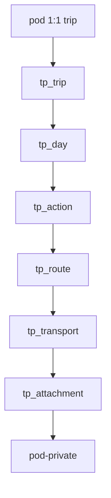

# In-app trip planning — feature plan

Stippl-inspired **day-by-day itineraries** inside SimpleOutcome: each **day** lists ordered **actions** (travel, stay, activity, note) plus **read-only mirrors** for multi-night **stays** and multi-day **travel**. **Travel** → alternative **routes** → ordered **transports**. Optional **budget**, **costs**, and **attachments** (images + PDF on transports only) — without map tiles, booking marketplaces, or affiliate clutter in v1.

**Repo:** [CoolColdUK/simpleOutcomeDev](https://github.com/CoolColdUK/simpleOutcomeDev)  
**Related:** [API keys, REST, and MCP](./api-mcp.md) (agent surface — trip tools are **phase 2**), [Telegram bot bridge](https://github.com/CoolColdUK/simpleOutcomeDev/blob/cursor/telegram-bridge-plan-f6f2/plan/feature/telegram-bridge.md) (separate track; ships **before** this feature)

**Product positioning:** In-app SimpleOutcome feature (web UI first). Not external Travel assistant bots.

This is a **plan / requirements** document. Product code waits until Matthew approves this plan on the implementation PR branch, then lands on **that same branch**.

---

## Sequencing (Matthew’s queue)

| Order | Track | Notes |
| --- | --- | --- |
| 1 | [Telegram bridge](https://github.com/CoolColdUK/simpleOutcomeDev/blob/cursor/telegram-bridge-plan-f6f2/plan/feature/telegram-bridge.md) | Ships before trip planning. |
| 2 | **Trip planning (this plan)** | `trip_planning` pod kind; day → action model. |
| 3 | Agent surface (optional) | REST / MCP after in-app v1 — extend [api-mcp.md](./api-mcp.md). |
| 4 | Cross-feature links (optional) | Soft links to **todo** / **financial planning** — phase 2. |

Do not fold trip planning into the Telegram PR.

---

## Decisions (locked)

Matthew confirmed in Technical Forum (Oct 2026). Do not re-litigate without a new decision.

| # | Topic | Decision |
| --- | --- | --- |
| 1 | **Cardinality** | **One trip per pod.** No trip list inside a pod. |
| 2 | **Multi-city** | **Yes in v1** — ordered `primary_destinations` text; no routing engine. |
| 3 | **Authz** | **Pod roles** only. Repo today has `pod_owner` / `pod_admin` / `pod_user` only — **add `pod_viewer`** platform-wide (slice 0). Viewers read itinerary + download attachments; no writes/uploads. |
| 4 | **Costs / budget** | **Yes in v1** — trip-level budget; optional costs on **actions** (stay/activity/note) and on each **transport**; travel action rollup uses **selected route** transports. |
| 5 | **Core itinerary model** | **Day → ordered actions.** Kinds: `travel`, `stay`, `activity`, `note`. **Travel:** action → alternative **routes** → ordered **transports**. One **selected** route per travel action. **No** trip-level whole-journey plan in v1. |
| 6 | **Stay (lodging)** | First-class **`stay` action** with **`check_in_at`** / **`check_out_at`** (timestamptz). Lodging **spans nights** between them. **Show the stay on every calendar day** from check-in date through check-out date (inclusive, trip timezone) on the day strip — not a single-day card only. **Overlapping stays** on the same night with “winner” override → **out of v1** (known gap: render both; no conflict UI). |
| 7 | **Multi-day travel** | Transports use **`depart_at`** / **`arrive_at`**. Span = **selected route** (first transport depart → last transport arrive). **One canonical `tp_action` row** (editable). **Read-only mirrors** on **every calendar day** from departure date through arrival date (**inclusive**), including multi-day flights **> 24 h** and intermediate days — same `action_id`, no second write target. **Canonical list position** / `sort_order` lives on **anchor day** (departure date of span). Mirrors are display-only rows (tap → scroll/focus canonical editor or navigate to anchor day). |
| 8 | **Attachments** | **v1:** **images + PDF only**. **`tp_transport` only**; **`pod-private`**, **5 MB**. Trip/day dump → phase 2. |
| 9 | **Cross-feature** | Todo / FP soft links → **phase 2**. |
| 10 | **Map / bookings** | No map SDK; no booking marketplaces. |
| 11 | **Travellers** | Multiple named travellers → **later**. |

**Engineering defaults:** leg times stored UTC; day boundaries use trip `timezone`. Shortening trip dates with content on removed days → confirm before `syncTpDaysForTrip`.

### Superseded (do not implement in v1)

| Previous plan idea | Replacement |
| --- | --- |
| `tp_item` + `tp_alternative_group` + `tp_travel_leg` | `tp_action` + `tp_route` + `tp_transport` |
| Trip-level `tp_travel_plan` (whole-journey compare) | **Out of v1** — optional phase 2 |
| Attachments on trip / day / action | **Transport only** in v1 |
| Travel: departure day only + single arrival ghost | **Every day in span** gets a read-only mirror; one canonical action |

---

## Goal

1. **Top-down:** create `trip_planning` pod → dates + **multi-city** destinations → fill each **day** with **actions**.
2. **List / timeline-first** (day strip + action cards). Places as **text** + optional maps URL — **no map SDK**.
3. **Travel** actions: add alternative **routes**, each with sequential **transports**; pick a **selected** route.
4. **Share** via space/pod membership; **`pod_viewer`** for read-only.
5. **Budget** + line costs; **PDF/image** tickets on transports.
6. No booking engines or affiliate UI.

---

## Principles

| Principle | Detail |
| --- | --- |
| Day → action | The day timeline is an ordered list of actions, not a flat mix of items and separate OR widgets. |
| Travel = routes × transports | Alternatives are **routes** under one travel action; each route is a **sequence** of transports. |
| One trip per pod | Opening the pod opens the single itinerary. |
| Spanning stays & travel | Stays and long-haul travel appear on **each covered calendar day**; one DB row, mirrors for read-only repeat. |
| Transport = attachment target | Booking PDFs bind to the segment they belong to. |
| Platform `pod_viewer` | Added for all pod kinds; trip is first feature that **needs** view-only sharing. |
| Storage reuse | [`pod-private`](packages/model/src/todo/constants.ts) + todo-style upload helpers. |
| Telegram / agents later | Product UI first. |

---

## Inspiration vs out of scope (v1)

| In | Out of v1 |
| --- | --- |
| Day-by-day actions; multi-night **stay**; travel mirrors on all span days | Map SDK, route maps |
| | Overlapping stay conflict resolution |
| Route alternatives + multi-modal transports | Trip-level “Plan A vs Plan B” journey compare |
| Budget + transport/action costs | Booking marketplaces |
| Image/PDF on **transport** | Attachments on trip/day; trip file dump (**phase 2**) |
| `pod_viewer` sharing | Per-traveller profiles, Telegram trip commands |
| | Soft todo/FP links (**phase 2**) |
| | AI trip generation |

---

## Product context

### Where it lives

- **`FeatureKind.TRIP_PLANNING = 'trip_planning'`** on `pod`.
- **One `tp_trip` per pod** (`unique (pod_id)`).
- Wizard on pod create (or first open).

### Membership and roles

**Today:** [`PodRole`](packages/model/src/space/podRole.ts) has no viewer; `pod_member.role_check` allows three roles only.

**Add `pod_viewer`:** read trip + signed attachment URLs; no mutations. Editors use `pod_user` / `pod_admin` / `pod_owner`. Update member RPCs, labels, todo/fp/trip RLS and storage policies (slice 0).

---

## Core objects (schema sketch)

Prefix `tp_*`. RLS: `app_private.tp_can(pod_id, read|write|manage_settings)`.

### Trip (`tp_trip`)

| Column | Notes |
| --- | --- |
| `pod_id` | **unique** FK |
| `title`, `timezone` | |
| `start_date`, `end_date` | Inclusive |
| `primary_destinations` | `text[]`, ordered multi-city |
| `status` | `draft` \| `active` \| `done` \| `archived` |
| `budget_amount`, `budget_currency` | Optional |
| `maps_url`, `notes` | Optional |

### Day (`tp_day`)

| Column | Notes |
| --- | --- |
| `trip_id`, `day_index`, `calendar_date` | |
| `label`, `notes` | Optional |

Synced when trip dates change.

### Action (`tp_action`)

One row per logical action. **Day strip** also shows **mirrors** (computed or materialized view) for spanning **stay** and **travel** — see [Multi-day display](#multi-day-display-stay-and-travel).

| Column | Notes |
| --- | --- |
| `trip_id` | FK |
| `anchor_day_id` | FK → `tp_day`; **canonical** day for `sort_order` and primary edit entry. **Stay:** check-in calendar day. **Travel:** departure calendar day of selected-route span. **Activity / note:** the day they belong to. Null → **ideas** bucket. |
| `kind` | `travel` \| `stay` \| `activity` \| `note` |
| `title` | Required |
| `place_text`, `maps_url` | Optional |
| `check_in_at`, `check_out_at` | **Stay only** — timestamptz; defines night span |
| `start_time`, `end_time` | **Activity / note** — optional local times on `anchor_day_id` |
| `cost_amount`, `cost_currency` | Optional on **stay / activity / note** (count **once** in budget, not per mirror day) |
| `booking_ref`, `url`, `notes` | Optional |
| `selected_route_id` | **Travel only** — route used for display span, mirrors, and budget |
| `sort_order` | Order among actions on **`anchor_day_id`** only |

**Travel** actions own `tp_route` / `tp_transport` children. **Do not** duplicate `tp_action` rows per mirror day.

**Naming:** `anchor_day_id` replaces an earlier `day_id` sketch; same meaning for non-spanning kinds.

### Route (`tp_route`)

Alternative way to complete a **travel** action (e.g. “Via coach” vs “Via train + taxi”).

| Column | Notes |
| --- | --- |
| `action_id` | FK → `tp_action` where `kind = travel` |
| `name` | Short label |
| `is_selected` | At most one `true` per `action_id` (app + DB guard) |
| `notes`, `sort_order` | |

`selected_route_id` on the action should stay in sync with `is_selected` (single source of truth: prefer **action.selected_route_id** with route `is_selected` derived in reads, or trigger — pick one in implementation).

### Transport (`tp_transport`)

One **segment** within a route (former “leg”). Ordered multi-modal chain.

| Column | Notes |
| --- | --- |
| `route_id` | FK → `tp_route` |
| `mode` | `flight` \| `train` \| `coach` \| `bus` \| `car` \| `ferry` \| `walk` \| `other` |
| `from_text`, `to_text` | |
| `depart_at`, `arrive_at` | **timestamptz**; may span days |
| `cost_amount`, `cost_currency` | Optional |
| `booking_ref`, `url`, `notes` | |
| `sort_order` | Within route |

**Attachments** hang off `transport_id` only (see below).

### Multi-day display (stay and travel)

Mirrors are **not** separate editable actions. One `tp_action.id` everywhere.

**Calendar-day helper** (trip `timezone`): `tpCalendarDate(ts)` → local date; `tpInclusiveDateRange(startTs, endTs)` → every date from start through end (inclusive).

| Kind | Span source | Days that show a row |
| --- | --- | --- |
| **Stay** | `check_in_at` … `check_out_at` | Every calendar date **from check-in date through check-out date** (inclusive). Card copy: “Check-in”, “Night N”, “Check-out” as appropriate per day. |
| **Travel** | Selected route: min(`depart_at`) → max(`arrive_at`) across its transports | **Every calendar date** in that inclusive range (covers overnight, **> 24 h** flights, arrival day, and **all intermediate days**). |
| **Activity / note** | `anchor_day_id` only | Single day (no mirrors). |

**Mirror row rules (UI model):**

| Field | Canonical (anchor day) | Mirror (other span days) |
| --- | --- | --- |
| `action_id` | same | same |
| `display_mode` | `canonical` | `mirror` |
| Editing | Full form / drag reorder on anchor day | **Read-only** summary; tap opens canonical editor (same route/transport ids) |
| `sort_order` | Stored on action | Mirrors sort after same-day canonical actions (fixed rule in `@so/model`, e.g. end of list or grouped “in progress”) |

**Implementation note:** Prefer **computed** mirrors in list queries (`listTpDayTimeline(dayId)`). Optional materialized `tp_action_day_mirror(action_id, day_id, display_mode)` only if perf requires — not required for v1.

**Stay overlap (v1 gap):** If two stays cover the same night, **both** mirrors render; no “primary stay” picker until later.

**Travel anchor:** On save, set `anchor_day_id` to departure date of selected-route span; recompute mirrors when route selection or transport times change.

### Pod settings (`tp_setting`)

| Column | Notes |
| --- | --- |
| `pod_id` | 1:1 |
| `default_currency` | For budget/cost fields |

### Attachments (`tp_attachment`) — v1

| Column | Notes |
| --- | --- |
| `transport_id` | FK → `tp_transport`, on delete cascade |
| `pod_id`, `trip_id` | Denormalized for RLS |
| `storage_path` | `pod-private` key |
| `file_name`, `mime_type`, `byte_size` | |
| `uploaded_by`, `created_at` | |

**MIME (locked):** `image/jpeg`, `image/png`, `application/pdf` only — migration extends `storage.buckets.allowed_mime_types` (drop webp from earlier draft).

**Path:** `{pod_id}/tp/transport/{transport_id}/{attachment_id}-{safe_filename}`

**Limits:** **5 MB** per file (bucket default); cap e.g. **10 files per transport** (`@so/model` constant).

**Authz:** write = non-viewer pod member with `tp_can` write; read = any member including viewer → signed URL.

### Budget rollup (v1)

| Source | Included when |
| --- | --- |
| `stay` / `activity` / `note` | `cost_*` on action **once** (not multiplied by mirror days; ideas optional in UI) |
| `travel` actions | Sum `cost_*` on all transports of **`selected_route_id`** (if none selected, travel contributes 0 + UI warning) |
| Total vs `tp_trip.budget_amount` | Header or Budget panel; no FX |

---

## UX (v1)

### 1. Create pod / trip wizard

When + multi-city where + title + timezone + optional budget → `tp_trip` + `tp_day` rows → land on day 1.

### 2. Day timeline

- Day strip; per day: **canonical actions** for that `anchor_day_id` plus **mirror** rows for spanning stay/travel.
- **+ Add action** → kind.
- **Stay:** check-in / check-out datetimes (and property place text); card appears on **each night/day** in range; edit on **check-in anchor day** (or tap mirror → jump to anchor).
- **Activity / note:** single-day on anchor day.
- **Travel:** routes + transports; **selected route** drives span. Canonical editor on **departure day**; **mirrors** on every subsequent span day (including multi-day flights) — read-only, same `action_id`.
- Mirror cards show condensed route/transport summary (“In flight · arrives Tue 14:30”, “Night 2 of 3 at Hotel X”).
- **Ideas:** `anchor_day_id` null.

### 3. Attachments

- Upload control **on each transport** row (image/PDF); list + download; delete for editors.
- No upload on trip, day, or non-travel action in v1.

### 4. Budget

- Trip budget in header/settings; costs on actions/transports; rollup vs budget.

### 5. Sharing

- Space + pod membership; assign **`pod_viewer`**.

### 6. Visual

- No map SDK; optional external link on place text.
- Route comparison: side-by-side or tabs with total duration/cost hint from transports.

---

## Implementation sketch

Pattern: [financial planning implementation](./financial%20planning-implementation.md).

### Suggested slices

| Slice | Deliverable |
| --- | --- |
| **0** | **`pod_viewer`** platform-wide (migration, `PodRole`, RPCs, UI picker, read-only storage/todo/fp/trip) |
| A | `FeatureKind.TRIP_PLANNING`; `tp_setting`; `tp_trip` + `tp_day`; wizard; day strip shell |
| B | `tp_action` — `activity`, `note`; ideas; reorder; costs; `anchor_day_id` |
| B2 | **`stay`** with `check_in_at` / `check_out_at`; multi-day **mirrors** on day strip |
| C | `tp_route` + `tp_transport`; travel UI; route select; multi-modal ordering |
| D | **Travel span mirrors** — all inclusive calendar days (incl. >24h); `listTpDayTimeline` + mirror sort; anchor sync; stay/travel mirror UX (tap → canonical) |
| E | Budget rollup UI; trip status/archive |
| F | `tp_attachment` + bucket MIME (jpeg/png/pdf) + transport upload/download |

### Services (names illustrative)

- `syncTpDaysForTrip`
- `{action}DbTpTrip`, `DbTpDay`, `DbTpAction`, `DbTpRoute`, `DbTpTransport`, `DbTpAttachment`
- `uploadStorageTpTransportAttachment`, signed URL helpers
- `@so/model`: `tpBudgetRollup`, `tpInclusiveDateRange`, `tpStaySpanDates`, `tpTravelSpanDates` (selected route), `tpDayTimelineEntries` (canonical + mirrors) — **unit tests**

### REST / MCP

After in-app v1; tool names align to action/route/transport (`list_tp_actions`, …). Attachment upload optional in agent v1.

### Phase 2 (not v1)

- Trip-level attachment library / zip dump
- Trip-level whole-journey plan compare (`tp_travel_plan` style)
- Soft links todo / FP
- Telegram / AI trip features

---

## Success criteria

- Plan reflects **spanning stays**, **travel mirrors on every span day**, day → action → route → transport, transport-only attachments, prior locks (one trip/pod, multi-city, `pod_viewer`, budget, Telegram-first, map-free).
- Slices **0** + **A** are unambiguous for implementation.

---

## Approval

Matthew: **approve** on the PR. Implementation on **`cursor/trip-planning-plan-bd93`** unless you choose another branch name.
