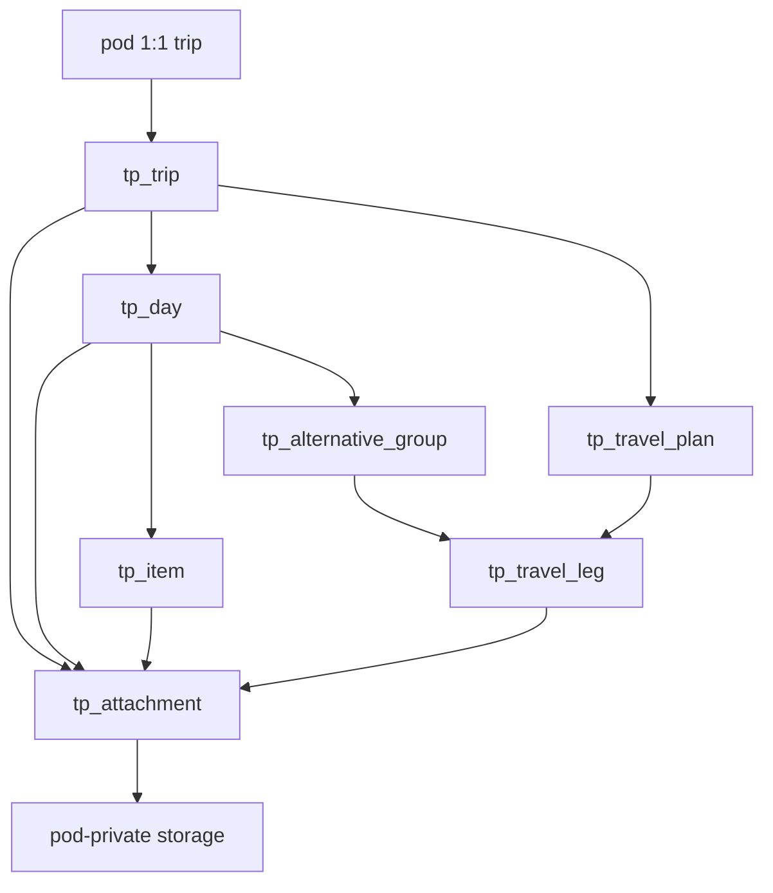

# In-app trip planning — feature plan

Stippl-inspired **day-by-day itineraries** inside SimpleOutcome: destinations, stays, activities, meals, notes, **file attachments**, optional **costs and trip budget**, and **multiple alternative travel plans** — without slow map tiles, booking marketplaces, or affiliate clutter in v1.

**Repo:** [CoolColdUK/simpleOutcomeDev](https://github.com/CoolColdUK/simpleOutcomeDev)  
**Related:** [API keys, REST, and MCP](./api-mcp.md) (agent surface — trip tools are **phase 2**), [Telegram bot bridge](https://github.com/CoolColdUK/simpleOutcomeDev/blob/cursor/telegram-bridge-plan-f6f2/plan/feature/telegram-bridge.md) (separate track; ships **before** this feature)

**Product positioning:** This is an **in-app SimpleOutcome product feature** (web UI first). It is **not** the external Travel assistant bots or a generic chat trip generator.

This is a **plan / requirements** document. Product code waits until Matthew approves this plan on the implementation PR branch, then lands on **that same branch** (not a separate implementation PR by default).

---

## Sequencing (Matthew’s queue)

| Order | Track | Notes |
| --- | --- | --- |
| 1 | [Telegram bridge](https://github.com/CoolColdUK/simpleOutcomeDev/blob/cursor/telegram-bridge-plan-f6f2/plan/feature/telegram-bridge.md) | Plan + implementation on `cursor/telegram-bridge-plan-f6f2` (or follow-on branch). Todo-focused v1 chat adapter. |
| 2 | **Trip planning (this plan)** | Product UI in `packages/web`; new `trip_planning` pod kind. |
| 3 | Agent surface (optional) | REST / MCP tools for trips after the in-app feature is stable — extend [api-mcp.md](./api-mcp.md) with `pods[podId].trip` (name TBD). |
| 4 | Cross-feature links (optional) | Soft links from trip items to **todo** cards and **financial planning** transactions — not v1 blockers. |

Do not fold trip planning into the Telegram PR or bridge v1 scope.

---

## Decisions (locked)

Matthew confirmed in Technical Forum (Oct 2026). Implementation should not re-litigate these without a new decision.

| # | Topic | Decision |
| --- | --- | --- |
| 1 | **Cardinality** | **One trip per pod.** The pod is the trip container (like one todo board per pod). No trip list inside a pod. |
| 2 | **Multi-city** | **Yes in v1.** Multiple cities/regions on a trip via ordered `primary_destinations` text — no routing engine. |
| 3 | **Authz / collaborators** | Use **pod roles**, not a parallel collaborator system. Today [`PodRole`](packages/model/src/space/podRole.ts) is only `pod_owner`, `pod_admin`, `pod_user` — **no read-only role** (`pod_member.role_check` in migrations matches that trio). **Add `pod_viewer` (read-only)** as a **platform** pod role in the same implementation track (member picker, RPCs, RLS helpers). Viewers can read the itinerary and download attachments; they cannot mutate trip data or upload files. |
| 4 | **Costs / budget** | **Yes in v1.** Optional `cost_amount` / `cost_currency` on **items** and **travel legs**; **trip-level budget** (amount + currency, default from pod settings). UI shows a simple rollup (planned spend vs budget). |
| 5 | **Travel model** | **Confirmed split:** day-level **`tp_alternative_group`** + legs (mutually exclusive options on a day) **and** trip-level **`tp_travel_plan`** + ordered legs (whole-journey alternatives). `is_selected` on a plan; `selected_leg_id` on each alternative group. |
| 6 | **Cross-feature** | **Phase 2:** optional soft links (`linked_todo_card_id`, `linked_fp_transaction_id`, or a small link table) — **not** v1 scope. |
| 7 | **Attachments** | **In v1.** Upload booking confirmations, tickets, PDFs, images — reuse **`pod-private`** Supabase Storage (see [File attachments](#file-attachments-v1)). |
| 8 | **Map / bookings** | No map SDK; no booking marketplaces (unchanged). |
| 9 | **Travellers** | One logical planning owner per pod; **multiple named travellers** on a trip is **later**. |

**Timezone / archive (engineering defaults unless Matthew overrides during implementation):** store leg `depart_at` / `arrive_at` in UTC; day boundaries use trip `timezone`. Shortening the date range with content on dropped days → confirm dialog before regenerating days.

---

## Goal

1. Plan a trip **top-down**: create a **`trip_planning` pod** (one trip), set **dates / duration** and **multiple destination** strings, then fill **days** with items, alternatives, and travel plans.
2. **List / timeline-first UI** (day strip + per-day lists). Places are **text** with an optional **user-pasted** maps URL — **no map SDK** in v1.
3. Support **multiple alternative travel plans** at trip level and **grouped leg alternatives under a day** without forcing a single booked itinerary.
4. **Share** via existing **space / pod membership**; assign **`pod_viewer`** for read-only collaborators, **`pod_user`** / **`pod_admin`** for editors.
5. Optional **budget** and **line-item costs**; **attachments** on trip, day, item, and leg.
6. No hotel/flight **booking engines** or affiliate UI in v1.

---

## Principles

| Principle | Detail |
| --- | --- |
| Top-down, not map-first | Pod create / trip wizard → days → items/legs. No map-first workflow. |
| One trip per pod | Pod name and trip title may align at create time; opening the pod opens the itinerary directly. |
| Fast UI | Day strip + lists; reorder via drag handles. No interactive route map. |
| Places as text | Destinations and leg from/to are **free text**. Optional `maps_url` — outbound link only. |
| Alternatives are first-class | OR groups and trip-level plans are visible, comparable, and selectable. |
| Same pod pattern | `trip_planning` pod in a **space**; RLS by `pod_id`; cascade delete with pod. |
| Platform viewer role | `pod_viewer` is added for **all** pod kinds (todo, fp, trip) so view-only sharing is consistent. |
| Reuse storage | Attachments use existing **`pod-private`** bucket patterns from todo card icons ([`BUCKET_POD_PRIVATE`](packages/model/src/todo/constants.ts), [`uploadStorageTodoCardIcon`](packages/web/lib/api/storage/uploadStorageTodoCardIcon.ts)). |
| Agent later | Web product first; MCP/REST after stable. |
| Separate from Telegram | Telegram bridge does not manage trips in v1. |

---

## Inspiration vs out of scope (v1)

| Stippl-like (in) | Out of v1 |
| --- | --- |
| Day-by-day itinerary, multi-city text destinations | Interactive map tiles, route polylines, map SDK |
| Stays, activities, transport legs, alternatives | Booking / affiliate marketplaces |
| Trip budget + optional line costs | AI full-trip generation (optional later) |
| Notes, booking refs, **file uploads** | eSIM, reels, social feed |
| Share via space/pod + **viewer role** | Per-traveller profiles |
| Paste external URL in notes | Telegram bot commands for trips |
| | Packing lists (unless trivial “note” items) |
| | Soft links to todo / FP (**phase 2**) |

---

## Product context (SimpleOutcome domain)

### Where it lives

- New catalog value: **`FeatureKind.TRIP_PLANNING = 'trip_planning'`** (align with `pod_feature_check` and `create_pod`).
- User creates a **pod** of kind `trip_planning` in a **space** via [`SpaceCreatePodDialog`](packages/web/components/app/SpaceCreatePodDialog.tsx) / `create_pod`.
- **Exactly one `tp_trip` row per pod** (`unique (pod_id)`). Creating the pod runs the trip wizard (or creates an empty draft trip row immediately).

### Membership and roles

**Current repo state:** [`PodRole`](packages/model/src/space/podRole.ts) = `OWNER` | `ADMIN` | `USER` only. `public.pod_member.role` check constraint allows those three strings. There is **no** viewer/read-only pod role today.

**Planned (locked):** add **`PodRole.VIEWER = 'pod_viewer'`** platform-wide:

| Role | Trip planning v1 |
| --- | --- |
| `pod_viewer` | **Read** trip, days, items, plans, legs, attachments (signed download URLs). **No** create/update/delete, **no** uploads. |
| `pod_user` | Read + create/update/delete itinerary content and attachments (not pod delete / not member admin). |
| `pod_admin` | Same as user plus pod admin actions per existing pod rules. |
| `pod_owner` / space owner | Full control including pod settings, budget currency default, member roles. |

Implementation must update: `pod_member` check, `add_pod_member_by_username` / `update_pod_member_role`, [`podRoleLabel`](packages/model/src/space/podRoleLabel.ts), group/agent role picklists, **todo** and **fp** read vs write helpers where membership gates UI, and **storage RLS** (viewers: `select` only on `pod-private` objects for pods they can read).

No separate “trip collaborator” table.

### API keys (future)

- Grant: `pods[podId].trip` with Create/Read/Update/Delete.
- `pod_viewer` membership still gates role matrix on the key owner’s effective rights.
- Not part of Telegram bridge v1.

---

## Core objects (schema sketch)

Prefix `tp_*`. UUID PKs, `moddatetime` on `updated_at`, RLS via `app_private.tp_can(p_pod_id, p_action)` (`read` | `write` | `manage_settings`).

### Trip (`tp_trip`)

One row per pod.

| Column | Type | Notes |
| --- | --- | --- |
| `id` | uuid | PK |
| `pod_id` | uuid | FK → `pod`, **unique**, on delete cascade |
| `title` | text | Display name (may mirror pod name) |
| `timezone` | text | IANA; day boundaries |
| `start_date`, `end_date` | date | Inclusive range |
| `primary_destinations` | text[] | **Ordered multi-city** list |
| `status` | enum | `draft` \| `active` \| `done` \| `archived` |
| `budget_amount` | numeric | Optional trip budget |
| `budget_currency` | text | ISO 4217; default from `tp_setting` |
| `maps_url`, `notes` | text | Optional |
| `created_at`, `updated_at` | timestamptz | |

**Derived days:** `syncTpDaysForTrip` upserts `tp_day` when dates change; warn if shortening drops days with content.

### Day (`tp_day`)

| Column | Type | Notes |
| --- | --- | --- |
| `id` | uuid | PK |
| `trip_id` | uuid | FK |
| `day_index` | int | 0-based |
| `calendar_date` | date | In trip timezone |
| `label`, `notes` | text | Optional |

### Itinerary items (`tp_item`)

| Column | Type | Notes |
| --- | --- | --- |
| `id` | uuid | PK |
| `trip_id` | uuid | FK |
| `day_id` | uuid | Nullable → **ideas** bucket |
| `kind` | enum | `stay` \| `activity` \| `meal` \| `note` \| `other` |
| `title`, `place_text`, `maps_url` | text | |
| `start_time`, `end_time` | time | Optional |
| `cost_amount`, `cost_currency` | numeric, text | Optional |
| `booking_ref`, `url`, `notes` | text | |
| `sort_order` | int | |

### Trip-level travel plans (`tp_travel_plan`)

| Column | Type | Notes |
| --- | --- | --- |
| `id` | uuid | PK |
| `trip_id` | uuid | FK |
| `name` | text | |
| `is_selected` | boolean | At most one `true` per trip (app + constraint/trigger) |
| `notes`, `sort_order` | | |

### Travel leg (`tp_travel_leg`)

Exactly one of `travel_plan_id` or `alternative_group_id` set.

| Column | Type | Notes |
| --- | --- | --- |
| `id` | uuid | PK |
| `travel_plan_id` | uuid | Nullable |
| `alternative_group_id` | uuid | Nullable |
| `day_id` | uuid | Required when in an alternative group |
| `mode` | enum | `flight` \| `train` \| `coach` \| `bus` \| `car` \| `ferry` \| `walk` \| `other` |
| `from_text`, `to_text` | text | |
| `depart_at`, `arrive_at` | timestamptz | Optional UTC |
| `cost_amount`, `cost_currency` | | Optional |
| `booking_ref`, `url`, `notes` | text | |
| `sort_order` | int | |

### Alternative group (`tp_alternative_group`)

| Column | Type | Notes |
| --- | --- | --- |
| `id` | uuid | PK |
| `day_id` | uuid | FK |
| `title` | text | e.g. “Arrival transfer” |
| `selected_leg_id` | uuid | Nullable |
| `sort_order` | int | |

### Pod settings (`tp_setting`)

| Column | Notes |
| --- | --- |
| `pod_id` | 1:1 with pod |
| `default_currency` | For new cost/budget fields |

### File attachments (v1)

Metadata table + objects in **`pod-private`** (existing bucket from todo migration).

**`tp_attachment`**

| Column | Type | Notes |
| --- | --- | --- |
| `id` | uuid | PK |
| `pod_id` | uuid | Denormalized for RLS |
| `trip_id` | uuid | FK |
| `parent_type` | enum | `trip` \| `day` \| `item` \| `travel_leg` |
| `parent_id` | uuid | Id of parent row |
| `storage_path` | text | Object key in `pod-private` |
| `file_name` | text | Original name |
| `mime_type` | text | |
| `byte_size` | int | |
| `uploaded_by` | uuid | FK profile |
| `created_at` | timestamptz | |

**Storage path (proposed):** `{pod_id}/tp/{parent_type}/{parent_id}/{attachment_id}-{safe_filename}` — first segment remains `pod_id` so existing [`pod_id_from_storage_object_name`](supabase/migrations/20260829114000_todo_list_pod_description.sql) keeps working.

**Limits (proposed, match todo spirit):**

| Limit | Value |
| --- | --- |
| Max file size | **5 MB** (existing bucket `file_size_limit`) |
| Allowed MIME | **Extend** bucket: `image/jpeg`, `image/png`, `image/webp`, `application/pdf` (migration `update` on `storage.buckets`) |
| Per parent cap | e.g. **20** attachments (constant in `@so/model`) |

**Authz:** `tp_can` write for upload/delete metadata + storage insert/delete policies using a new helper e.g. `app_private.can_write_trip_pod(pod_id)` (member with role ≠ `pod_viewer`). Read: any pod member who can read the pod (including viewer) → signed URL download.

**Services (sketch):** `uploadStorageTpAttachment`, `deleteStorageTpAttachment`, `listStorageTpAttachmentSignedUrls` — mirror todo storage helpers.

### Budget rollup (v1 UX)

- **Inputs:** all `tp_item.cost_*` on scheduled days + ideas (optional include/exclude ideas in UI); legs on the **selected** `tp_travel_plan`; for each alternative group, cost of **`selected_leg_id`** only (if unset, group contributes 0 to rollup).
- **Display:** `sum` vs `tp_trip.budget_amount` in trip header or Budget tab (no FX conversion).

---

## UX (v1)

### 1. Create pod / trip wizard

Triggered when user creates a `trip_planning` pod (or first open of empty pod):

1. **When:** start + end date (or duration → end).
2. **Where:** **multiple** destination fields (add city/region rows).
3. **Title** + timezone; optional **budget** + currency.
4. Creates pod (if not exists) + single `tp_trip` + `tp_day` rows → **day 1**.

### 2. Day timeline

- Day strip; per day: items + alternative groups.
- Reorder; **Ideas** for unscheduled items.
- Attach files on trip, day, item, or leg panels.

### 3. Travel section

- Compare **travel plans**; select primary plan.
- Per-day **alternative groups** with clear OR styling.

### 4. Budget

- Edit trip budget; enter costs on items/legs.
- Summary: planned total vs budget.

### 5. Sharing

- Space invite + pod membership; assign **`pod_viewer`** for read-only.

### 6. Visual design

- No map SDK; optional external link icon.
- Mobile-friendly day strip and stacks.

---

## Implementation sketch

Follow [financial planning implementation](./financial%20planning-implementation.md): migration → `@so/model` → `packages/web/lib/api/db/` → [`PodWorkspace`](packages/web/components/app/PodWorkspace.tsx).

### Suggested slices

| Slice | Deliverable |
| --- | --- |
| **0** | **`pod_viewer`** platform role: migration, `PodRole`, member RPCs/UI, read/write splits for todo/fp storage policies (viewers read-only). |
| A | `FeatureKind.TRIP_PLANNING`; `pod_feature_check`; `tp_setting`; empty `TripPlanningBoard` |
| B | `tp_trip` (1:1 pod), `tp_day`; wizard; day strip |
| C | `tp_item`; ideas; reorder; item costs |
| D | `tp_travel_plan`, `tp_travel_leg`; trip-level compare UI |
| E | `tp_alternative_group`; day OR legs; selection |
| F | Trip **budget** rollup UI; status/archive |
| G | **`tp_attachment`** + storage MIME extension + upload/download UI |

### Packages

| Area | Work |
| --- | --- |
| `supabase/migrations` | `tp_*` tables, RLS, `tp_can`, storage policy updates, bucket MIME extension |
| `packages/model` | Enums, schemas, caps, budget rollup helper, tests |
| `packages/web` | `components/tp/*`, storage helpers under `lib/api/storage/` |

### REST / MCP

After in-app v1: extend [api-mcp.md](./api-mcp.md) (`list_tp_*`, attachment upload likely **not** in agent v1 unless needed).

### Phase 2 (not v1)

- Soft links to todo cards and fp transactions.
- AI trip suggestions; Telegram trip commands.

---

## Success criteria

- Plan reflects **locked decisions**: one trip per pod, multi-city, `pod_viewer`, budget + costs, attachments, travel model split, Telegram-first sequencing, map-free.
- Engineer can start slice **0** + **A** without new product questions.

---

## Approval

Matthew: comment **approve** (or requested edits) on the PR. Implementation on **`cursor/trip-planning-plan-bd93`** (same branch as this plan) unless you prefer a fresh branch name.
