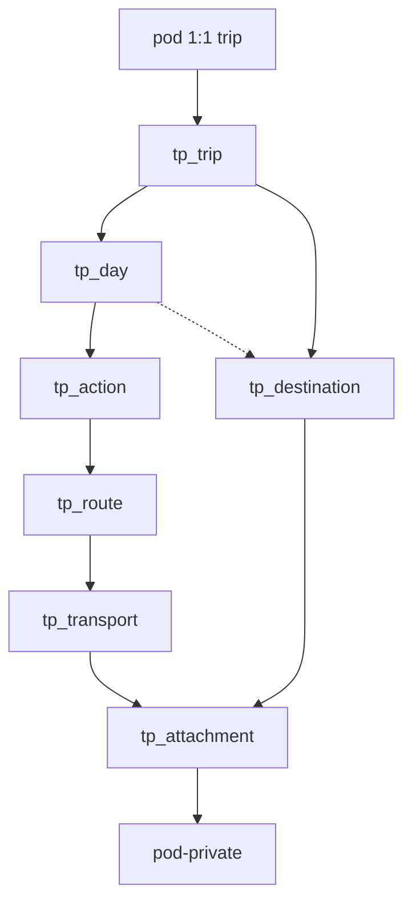

# In-app trip planning — feature plan

Stippl-inspired **day-by-day itineraries** inside SimpleOutcome: each **day** has a **planning header** (`day_title` / `day_notes`) plus ordered **actions** (travel, stay, activity, note) and **read-only mirrors** for spanning stay/travel. **Ordered destinations** carry **section-scoped safety / important info** (e.g. Japan vs Hong Kong). **Travel** → **routes** → **transports**; tickets attach to **transports**, safety PDFs to **destinations**. Optional **budget** and costs — no map SDK or booking marketplaces in v1.

**Repo:** [CoolColdUK/simpleOutcomeDev](https://github.com/CoolColdUK/simpleOutcomeDev)  
**Related:** [API keys, REST, and MCP](./api-mcp.md) (agent surface — trip tools are **phase 2**), [Telegram bot bridge](https://github.com/CoolColdUK/simpleOutcomeDev/blob/cursor/telegram-bridge-plan-f6f2/plan/feature/telegram-bridge.md) (separate track; ships **before** this feature)

**Product positioning:** In-app SimpleOutcome feature (web UI first). Not external Travel assistant bots.

**Status:** Approved (Matthew) — **v1 implementation** on PR #9 branch `cursor/trip-planning-plan-bd93`. This file remains the requirements source of truth.

---

## Sequencing (Matthew’s queue)

| Order | Track | Notes |
| --- | --- | --- |
| 1 | [Telegram bridge](https://github.com/CoolColdUK/simpleOutcomeDev/blob/cursor/telegram-bridge-plan-f6f2/plan/feature/telegram-bridge.md) | Ships before trip planning. |
| 2 | **Trip planning (this plan)** | `trip_planning` pod kind; day → action model. |
| 3 | Agent surface (optional) | REST / MCP after in-app v1 — extend [api-mcp.md](./api-mcp.md). |
| 4 | Cross-feature links (optional) | Soft links to **todo** / **financial planning** — phase 2. |

Do not fold trip planning into the Telegram PR.

---

## Decisions (locked)

Matthew confirmed in Technical Forum (Oct 2026). Do not re-litigate without a new decision.

| # | Topic | Decision |
| --- | --- | --- |
| 1 | **Cardinality** | **One trip per pod.** No trip list inside a pod. |
| 2 | **Multi-city / destinations** | **Yes in v1** — first-class ordered **`tp_destination`** rows (city/region labels; user may add “Japan (general)”, “Tokyo”, “Osaka”, “Hong Kong”). **No** separate country entity in v1. Wizard may seed destinations from multi-city input. No routing engine. |
| 3 | **Authz** | **Pod roles** only. Repo today has `pod_owner` / `pod_admin` / `pod_user` only — **add `pod_viewer`** platform-wide (slice 0). Viewers read itinerary + download attachments; no writes/uploads. |
| 4 | **Costs / budget** | **Yes in v1** — trip-level budget; optional costs on **actions** (stay/activity/note) and on each **transport**; travel action rollup uses **selected route** transports. |
| 5 | **Core itinerary model** | **Day → ordered actions.** Kinds: `travel`, `stay`, `activity`, `note`. **Travel:** action → alternative **routes** → ordered **transports**. One **selected** route per travel action. **No** trip-level whole-journey plan in v1. |
| 6 | **Stay (lodging)** | **`stay`** with **`check_in_at`** / **`check_out_at`** (timestamptz) plus **`check_in_timezone`** / **`check_out_timezone`** (IANA). Spans nights; **mirror on every trip-calendar day** the stay overlaps (see [Multi-day display](#multi-day-display-stay-and-travel)). Overlapping stays → **v1 gap** (show both). |
| 7 | **Multi-day travel display** | **Confirmed:** if travel spans multiple calendar days on the trip strip, **show on all of those days**. Span = **selected route** (first transport `depart_at` → last `arrive_at`). **One canonical `tp_action`**; **read-only mirrors** on every overlapped trip day (inclusive), including **> 24 h** flights and **all intermediate days** — same `action_id`. `sort_order` on **anchor day** only. |
| 8 | **Travel endpoints** | **Travel action:** overall **`from_place`** / **`to_place`** (city/region text) + optional **`from_maps_url`** / **`to_maps_url`** (journey intent A→Z). **Each transport:** segment **`from_place`** / **`to_place`** (airport/station names OK). **Single-transport route:** action endpoints **default from / sync with** the transport on save. **Multi-modal:** action = overall A→Z; transports = A→B, B→C, …, C→Z (first transport `from` should chain from action `from_place`; last `to` aligns with action `to_place` — validate in UI, soft warnings not hard block in v1). |
| 9 | **Timezones** | **Do not** assume one trip timezone for all dep/arr display. Store **timestamptz** instants **and** explicit **IANA** `depart_timezone` / `arrive_timezone` per transport (and check-in/out zones on stays). **`tp_trip.timezone`** = default for **generating the day strip** and fallback UI only. Display: **local time + abbreviation** per endpoint (e.g. `14:00 HKT → 18:30 GMT`). Calendar-day rules for mirrors: [Timezone and calendar rules](#timezone-and-calendar-rules). |
| 10 | **Day planning notes** | Each **`tp_day`** has optional **`day_title`** + **`day_notes`** (broad plan for that day, e.g. “Ghibli studio”) — **day fields**, not a `note` action. Shown at **top of day**; editable inline. Distinct from ordered **`note`** actions in the list. |
| 11 | **Important / safety info** | **Destination-scoped** in v1. **`important_info`** + attachments on **`tp_destination`**. **Primary surfacing path is automatic** — infer active destination(s) per day from **stays** (`destination_id` on overlapping stays) and **travel** (endpoint destinations on **transit days** via selected-route transports). **Optional `tp_day.primary_destination_id`** overrides inference on messy days. **Do not** require manual per-day tagging as the default workflow (`tp_day_destination` / date ranges are optional supplements only). |
| 12 | **Attachments** | **v1:** JPEG/PNG/PDF on **`tp_transport`** (tickets) **and** on **`tp_destination`** (safety docs). **`pod-private`**, **5 MB** per file. Not on trip/day/action in v1. |
| 13 | **Cross-feature** | Todo / FP soft links → **phase 2**. |
| 14 | **Map / bookings** | No map SDK; no booking marketplaces. |
| 15 | **Travellers** | Multiple named travellers → **later**. |

**Other defaults:** instants are canonical in UTC in Postgres; shortening trip dates with spanning content → confirm before `syncTpDaysForTrip`.

### Superseded (do not implement in v1)

| Previous plan idea | Replacement |
| --- | --- |
| `tp_item` + `tp_alternative_group` + `tp_travel_leg` | `tp_action` + `tp_route` + `tp_transport` |
| Trip-level `tp_travel_plan` (whole-journey compare) | **Out of v1** — optional phase 2 |
| Attachments on trip / day / action | **Transport + destination** only in v1 |
| `primary_destinations` text[] only | **`tp_destination`** rows + day/range linkage |
| Travel: departure day only + single arrival ghost | **Every day in span** gets a read-only mirror; one canonical action |

---

## Goal

1. **Top-down:** create pod → dates + **destinations** → per-day **header notes** + **actions**.
2. **List / timeline-first** (day strip + action cards). Places as **text** + optional maps URL — **no map SDK**.
3. **Travel** actions: add alternative **routes**, each with sequential **transports**; pick a **selected** route.
4. **Share** via space/pod membership; **`pod_viewer`** for read-only.
5. **Budget** + line costs; **PDF/image** tickets on transports.
6. No booking engines or affiliate UI.

---

## Principles

| Principle | Detail |
| --- | --- |
| Day → action | The day timeline is an ordered list of actions, not a flat mix of items and separate OR widgets. |
| Travel = routes × transports | Alternatives are **routes** under one travel action; each route is a **sequence** of transports. |
| One trip per pod | Opening the pod opens the single itinerary. |
| Spanning stays & travel | **Every overlapped trip-calendar day**; one DB row; mirrors elsewhere. |
| Endpoint timezones | Instants + IANA per transport/stay endpoint; trip TZ = strip only. |
| Journey A→Z | Travel action places + per-segment places. |
| Day header ≠ note action | `day_title` / `day_notes` are planning chrome above the action list. |
| Destination-scoped safety | Inferred from **stays and travel** by default; override only when needed. |
| Attachments | Tickets on **transport**; safety PDFs on **destination**. |
| Platform `pod_viewer` | Added for all pod kinds; trip is first feature that **needs** view-only sharing. |
| Storage reuse | [`pod-private`](packages/model/src/todo/constants.ts) + todo-style upload helpers. |
| Telegram / agents later | Product UI first. |

---

## Inspiration vs out of scope (v1)

| In | Out of v1 |
| --- | --- |
| Day header notes; destination **important info**; multi-night stay; travel mirrors | Map SDK, route maps |
| | Overlapping stay conflict resolution |
| Route alternatives + multi-modal transports | Trip-level “Plan A vs Plan B” journey compare |
| Budget + transport/action costs | Booking marketplaces |
| Image/PDF on **transport** + **destination** | Attachments on trip/day/action; trip file dump (**phase 2**) |
| Flat destination list (city/region) | Mandatory country hierarchy entity |
| `pod_viewer` sharing | Per-traveller profiles, Telegram trip commands |
| | Soft todo/FP links (**phase 2**) |
| | AI trip generation |

---

## Product context

### Where it lives

- **`FeatureKind.TRIP_PLANNING = 'trip_planning'`** on `pod`.
- **One `tp_trip` per pod** (`unique (pod_id)`).
- Wizard on pod create (or first open).

### Membership and roles

**Today:** [`PodRole`](packages/model/src/space/podRole.ts) has no viewer; `pod_member.role_check` allows three roles only.

**Add `pod_viewer`:** read trip + signed attachment URLs; no mutations. Editors use `pod_user` / `pod_admin` / `pod_owner`. Update member RPCs, labels, todo/fp/trip RLS and storage policies (slice 0).

---

## Core objects (schema sketch)

Prefix `tp_*`. RLS: `app_private.tp_can(pod_id, read|write|manage_settings)`.

### Trip (`tp_trip`)

| Column | Notes |
| --- | --- |
| `pod_id` | **unique** FK |
| `title`, `timezone` | IANA — **day strip** generation + default UI; not the only zone for travel/stay times |
| `start_date`, `end_date` | Inclusive |
| `status` | `draft` \| `active` \| `done` \| `archived` |
| `budget_amount`, `budget_currency` | Optional |
| `maps_url`, `notes` | Optional |

### Destination (`tp_destination`)

Ordered places / sections for the trip (replaces a standalone `primary_destinations` array).

| Column | Notes |
| --- | --- |
| `id` | uuid PK |
| `trip_id` | FK |
| `name` | e.g. `Tokyo`, `Japan (general)`, `Hong Kong` |
| `sort_order` | User ordering on trip overview |
| `maps_url` | Optional outbound link |
| `timezone_hint` | Optional IANA — UI default when adding times in this section |
| `important_info` | Optional markdown/text — safety, embassy, evac, local rules |
| `active_start_date`, `active_end_date` | Optional **coarse** section dates — **not** the primary surfacing path once itinerary exists; useful before stays/travel are filled |
| `notes` | Optional internal planner note (not shown as day header) |

**No `tp_country` table in v1** — broader regions are just destination rows (e.g. “Japan (general)”).

#### Which destinations surface on day D? (`tpActiveDestinationsForDay`)

**1. Override (optional):** If `tp_day.primary_destination_id` is set → **only** that destination’s important-info panel on D (ignores auto for surfacing). UI: “Pin safety info for this day” picker; clear to revert to auto.

**2. Auto inference (default):** When override is null, **union**:

| Signal | Rule |
| --- | --- |
| **Stay** | Each **stay** overlapping trip day D (mirror or canonical) with `destination_id` → include that destination. |
| **Travel (transit days)** | For each **travel** action overlapping D (selected route), inspect **transports** on that route: if D is the **departure local date** (`depart_timezone`) → include `from_destination_id` when set; if D is the **arrival local date** (`arrive_timezone`) → include `to_destination_id`; if D is an **intermediate** overlapped day (in transit, including **> 24 h** segments) → include **both** endpoint destinations for transports spanning D (or the in-progress segment’s from/to destinations). |
| **Name fallback** | If FKs unset, soft-match `from_place` / `to_place` / stay `place_text` to `tp_destination.name` (case-insensitive contains) — best-effort; UI nudges user to pick `destination_id` on stay/travel. |

**3. Optional supplements (not required for v1 happy path):**

- **`tp_day_destination`** — add an **extra** destination to a day’s panels (additive to auto).
- **Destination date range** — include destination on days in `[active_start_date, active_end_date]` **only when** auto inference would otherwise return empty (early planning skeleton).

Multiple destinations on one day → **stacked** collapsed panels (e.g. “Japan (general)” + “Tokyo”).

**Travel action fields (for auto):** optional **`from_destination_id`** / **`to_destination_id`** on `tp_action` (`kind = travel`) — set from wizard or when user picks destinations for overall A→Z; segment transports inherit unless overridden per transport (implementation may copy from action on create).

### Day (`tp_day`)

| Column | Notes |
| --- | --- |
| `trip_id`, `day_index`, `calendar_date` | |
| `day_title` | Optional short label (“Day 1 — Ghibli”) |
| `day_notes` | Optional longer rough plan for the day |
| `primary_destination_id` | Optional FK → `tp_destination` — **override** for important-info surfacing on this day only |

Synced when trip dates change. **Not** the same as a `note` **action** in the list below.

### Day ↔ destination (`tp_day_destination`) — optional supplement

| Column | Notes |
| --- | --- |
| `day_id`, `destination_id` | Composite PK; **additive** extra panel — **not** the primary way to assign destinations to days |

Use sparingly; prefer **auto-from-stay/travel** + `primary_destination_id` override.

### Action (`tp_action`)

One row per logical action. **Day strip** also shows **mirrors** (computed or materialized view) for spanning **stay** and **travel** — see [Multi-day display](#multi-day-display-stay-and-travel).

| Column | Notes |
| --- | --- |
| `trip_id` | FK |
| `anchor_day_id` | FK → `tp_day`; canonical **sort_order** + primary editor. **Travel:** trip day whose `calendar_date` matches **departure local date** (`localDate(depart_at, depart_timezone)` of first transport on selected route) mapped onto the strip — see calendar rules. **Stay:** trip day matching **check-in local date** in `check_in_timezone`. **Activity / note:** owning day. Null → ideas. |
| `kind` | `travel` \| `stay` \| `activity` \| `note` |
| `title` | Required |
| `destination_id` | Optional FK → `tp_destination` (**stay** recommended; optional on activity/note) |
| `place_text`, `maps_url` | **Stay** property; optional on activity/note |
| `from_place`, `to_place` | **Travel only** — overall journey endpoints (text) |
| `from_destination_id`, `to_destination_id` | **Travel only** — optional FKs for **auto** important-info on transit days |
| `from_maps_url`, `to_maps_url` | **Travel only** — optional outbound links |
| `check_in_at`, `check_out_at` | **Stay** — timestamptz instants |
| `check_in_timezone`, `check_out_timezone` | **Stay** — IANA at property |
| `start_time`, `end_time` | **Activity / note** — optional local times on `anchor_day_id` (trip TZ) |
| `cost_amount`, `cost_currency` | Optional on **stay / activity / note** (count **once** in budget, not per mirror day) |
| `booking_ref`, `url`, `notes` | Optional |
| `selected_route_id` | **Travel only** — route used for display span, mirrors, and budget |
| `sort_order` | Order among actions on **`anchor_day_id`** only |

**Travel** actions own `tp_route` / `tp_transport` children. **Do not** duplicate `tp_action` rows per mirror day.

**Naming:** `anchor_day_id` replaces an earlier `day_id` sketch; same meaning for non-spanning kinds.

### Route (`tp_route`)

Alternative way to complete a **travel** action (e.g. “Via coach” vs “Via train + taxi”).

| Column | Notes |
| --- | --- |
| `action_id` | FK → `tp_action` where `kind = travel` |
| `name` | Short label |
| `is_selected` | At most one `true` per `action_id` (app + DB guard) |
| `notes`, `sort_order` | |

`selected_route_id` on the action should stay in sync with `is_selected` (single source of truth: prefer **action.selected_route_id** with route `is_selected` derived in reads, or trigger — pick one in implementation).

### Transport (`tp_transport`)

One **segment** within a route (former “leg”). Ordered multi-modal chain.

| Column | Notes |
| --- | --- |
| `route_id` | FK → `tp_route` |
| `mode` | `flight` \| `train` \| `coach` \| `bus` \| `car` \| `ferry` \| `walk` \| `other` |
| `from_place`, `to_place` | Segment endpoints (text) |
| `depart_at`, `arrive_at` | **timestamptz** (absolute instants) |
| `depart_timezone`, `arrive_timezone` | **IANA** zones for endpoints (display + local-date semantics) |
| `cost_amount`, `cost_currency` | Optional |
| `booking_ref`, `url`, `notes` | |
| `sort_order` | Within route |

**Ticket attachments** hang off `transport_id` (see [Attachments](#attachments-tp_attachment--v1)).

### Multi-day display (stay and travel)

Mirrors are **not** separate editable actions. One `tp_action.id` everywhere.

**Reconfirmed (locked):** multi-day **travel** and multi-night **stay** both appear on **every trip-calendar day** they overlap — not only departure/check-in day.

### Timezone and calendar rules

**Trip day strip:** `tp_day.calendar_date` rows are interpreted in **`tp_trip.timezone`**. Each day D represents the half-open UTC interval `[startOfDay(D, tripTz), endOfDay(D, tripTz))`.

**Overlap test (travel and stay):** Let `[spanStart, spanEnd]` be the inclusive instant range:

| Kind | `spanStart` | `spanEnd` |
| --- | --- | --- |
| **Travel** (selected route) | First transport `depart_at` | Last transport `arrive_at` |
| **Stay** | `check_in_at` | `check_out_at` |

Show a **mirror** (or canonical row) on trip day D iff `dayInterval(D, tripTz)` **intersects** `[spanStart, spanEnd]`.

This covers **HKG → LHR** (different endpoint zones), **> 24 h** flights (many intersected days), and intermediate days without assuming a single global zone.

**Endpoint local dates (display only, not mirror set):**

| Event | Local date rule |
| --- | --- |
| Departure | `localDate(depart_at, depart_timezone)` |
| Arrival | `localDate(arrive_at, arrive_timezone)` |
| Check-in / out | `localDate(instant, check_in_timezone)` / `check_out_timezone` |

**Anchor day:** `anchor_day_id` = `tp_day` where `calendar_date` equals the **departure local date** (travel) or **check-in local date** (stay), using endpoint zones above. If no exact `tp_day` row (edge case), use first overlapped day on the strip.

**Display formatting (`@so/model`):** `formatTpInstant(instant, ianaZone)` → `14:00 HKT`; transport summary `departFormatted → arriveFormatted`.

| Kind | On each overlapped trip day |
| --- | --- |
| **Stay** | Mirror/canonical; copy “Check-in”, “Night n”, “Check-out” by comparing D to check-in/out **local dates** in stay zones. |
| **Travel** | Mirror on **all** overlapped days; canonical editor on anchor day only. |
| **Activity / note** | Single `anchor_day_id` only. |

**Mirror row rules (UI model):**

| Field | Canonical (anchor day) | Mirror (other span days) |
| --- | --- | --- |
| `action_id` | same | same |
| `display_mode` | `canonical` | `mirror` |
| Editing | Full form / drag reorder on anchor day | **Read-only** summary; tap opens canonical editor (same route/transport ids) |
| `sort_order` | Stored on action | Mirrors sort after same-day canonical actions (fixed rule in `@so/model`, e.g. end of list or grouped “in progress”) |

**Implementation note:** Prefer **computed** mirrors in list queries (`listTpDayTimeline(dayId)`). Optional materialized `tp_action_day_mirror(action_id, day_id, display_mode)` only if perf requires — not required for v1.

**Stay overlap (v1 gap):** If two stays cover the same night, **both** mirrors render; no “primary stay” picker until later.

**On save (travel):** Sync action `from_place`/`to_place` from single-transport route; recompute `anchor_day_id` and mirrors when selected route or transport times/zones change.

### Pod settings (`tp_setting`)

| Column | Notes |
| --- | --- |
| `pod_id` | 1:1 |
| `default_currency` | For budget/cost fields |

### Attachments (`tp_attachment`) — v1

Exactly one parent: **`transport_id`** OR **`destination_id`**.

| Column | Notes |
| --- | --- |
| `transport_id` | Nullable FK → `tp_transport` (booking tickets) |
| `destination_id` | Nullable FK → `tp_destination` (safety / evac PDFs, maps scans) |
| `pod_id`, `trip_id` | Denormalized for RLS |
| `storage_path` | `pod-private` key |
| `file_name`, `mime_type`, `byte_size` | |
| `uploaded_by`, `created_at` | |

**MIME (locked):** `image/jpeg`, `image/png`, `application/pdf` only.

**Paths:**

- Transport: `{pod_id}/tp/transport/{transport_id}/{attachment_id}-{safe_filename}`
- Destination: `{pod_id}/tp/destination/{destination_id}/{attachment_id}-{safe_filename}`

**Limits:** **5 MB** per file; cap e.g. **10 per transport**, **10 per destination** (`@so/model`).

**Authz:** write = non-viewer with `tp_can` write; read = any member including viewer → signed URL.

### Budget rollup (v1)

| Source | Included when |
| --- | --- |
| `stay` / `activity` / `note` | `cost_*` on action **once** (not multiplied by mirror days; ideas optional in UI) |
| `travel` actions | Sum `cost_*` on all transports of **`selected_route_id`** (if none selected, travel contributes 0 + UI warning) |
| Total vs `tp_trip.budget_amount` | Header or Budget panel; no FX |

---

## UX (v1)

### 1. Create pod / trip wizard

When + **destinations** (names; optional date ranges later) + title + timezone + optional budget → `tp_trip` + `tp_destination` + `tp_day` rows → land on day 1.

### 2. Day timeline

- **Day header** (top): edit **`day_title`** / **`day_notes`** inline — rough plan before detailed actions.
- **Important info panel(s):** computed by **`tpActiveDestinationsForDay`** (auto from stays + travel; override via **`primary_destination_id`**). Collapsed/expandable **`important_info`** + attachments per destination. Trip overview lists **all destinations** for editing content (not per-day assignment).
- Day strip; per day: **canonical actions** for that `anchor_day_id` plus **mirror** rows for spanning stay/travel.
- **+ Add action** → kind.
- **Stay:** check-in / check-out; **`destination_id`** picker (recommended — drives safety panels on all overlapped nights); property place text.
- **Activity / note:** single-day on anchor day.
- **Travel:** overall **from → to** on action; each transport segment places + **depart/arrive instants** with **depart/arrive timezone** pickers (default sensibly from previous segment or trip TZ). Summary line: **`14:00 HKT → 18:30 GMT`** style.
- **Selected route** drives span mirrors on **all overlapped trip days** (confirmed). Canonical editor on **anchor day**; other days read-only mirror, same `action_id`.
- Mirror cards: condensed route + active transport (“In flight · arrives Tue 18:30 GMT”, “Night 2 of 3 · Hotel X”).
- **Ideas:** `anchor_day_id` null.

### 3. Destinations (planner)

- Create/reorder destinations; edit **`important_info`** + safety attachments.
- Optional coarse **active date range** for skeleton trips (before stays exist).
- Per day: optional **pin** (`primary_destination_id`) only when auto is wrong — **not** required to tag every day.
- Optional **`tp_day_destination`** links for rare additive cases.

### 4. Attachments

- **Transport:** ticket/confirmation uploads on each transport row.
- **Destination:** safety/evac/reference files on destination editor.
- No upload on trip, day header, or actions in v1.

### 5. Budget

- Trip budget in header/settings; costs on actions/transports; rollup vs budget.

### 6. Sharing

- Space + pod membership; assign **`pod_viewer`**.

### 7. Visual

- No map SDK; optional external link on place text.
- Route comparison: side-by-side or tabs with total duration/cost hint from transports.

---

## Implementation sketch

Pattern: [financial planning implementation](./financial%20planning-implementation.md).

### Suggested slices

| Slice | Deliverable |
| --- | --- |
| **0** | **`pod_viewer`** platform-wide (migration, `PodRole`, RPCs, UI picker, read-only storage/todo/fp/trip) |
| A | `FeatureKind.TRIP_PLANNING`; `tp_setting`; `tp_trip` + `tp_day` (`day_title`/`day_notes`) + `tp_destination`; wizard; day strip + **day header** |
| A2 | **`tpActiveDestinationsForDay`** (auto stay/travel + override); **`primary_destination_id`**; optional `tp_day_destination`; important-info panels |
| B | `tp_action` — `activity`, `note`; ideas; reorder; costs; `anchor_day_id` |
| B2 | **`stay`** with `check_in_at` / `check_out_at`; multi-day **mirrors** on day strip |
| C | `tp_route` + `tp_transport`; travel **from/to** on action + segments; timezone fields; route select; multi-modal ordering; single-transport sync |
| D | **Overlap mirrors** (all trip days intersecting span, incl. >24h); `tpDayOverlapsTripDay`, `listTpDayTimeline`, anchor sync; `formatTpInstant` UX |
| E | Budget rollup UI; trip status/archive |
| F | `tp_attachment` (transport **+ destination** parents) + bucket MIME + upload/download UI |

### Services (names illustrative)

- `syncTpDaysForTrip`
- `{action}DbTpTrip`, `DbTpDay`, `DbTpDestination`, `DbTpDayDestination`, `DbTpAction`, `DbTpRoute`, `DbTpTransport`, `DbTpAttachment`
- `uploadStorageTpAttachment` (transport | destination parent), signed URL helpers
- `@so/model`: `tpActiveDestinationsForDay`, `tpDayInterval`, `tpSpanOverlapsTripDay`, `tpDayTimelineEntries`, `localDateInZone`, `formatTpInstant`, `tpBudgetRollup` — **unit tests**

### REST / MCP

After in-app v1; tool names align to action/route/transport (`list_tp_actions`, …). Attachment upload optional in agent v1.

### Phase 2 (not v1)

- Trip-level attachment library / zip dump
- Trip-level whole-journey plan compare (`tp_travel_plan` style)
- Soft links todo / FP
- Telegram / AI trip features

---

## Success criteria

- Plan reflects **day header notes**, **`tp_destination`** + scoped **important info**, **transport + destination attachments**, overlap mirrors, endpoint timezones, day → action → route → transport, prior locks.
- Slices **0** + **A** are unambiguous for implementation.

---

## Approval

Matthew: **approve** on the PR. Implementation on **`cursor/trip-planning-plan-bd93`** unless you choose another branch name.
